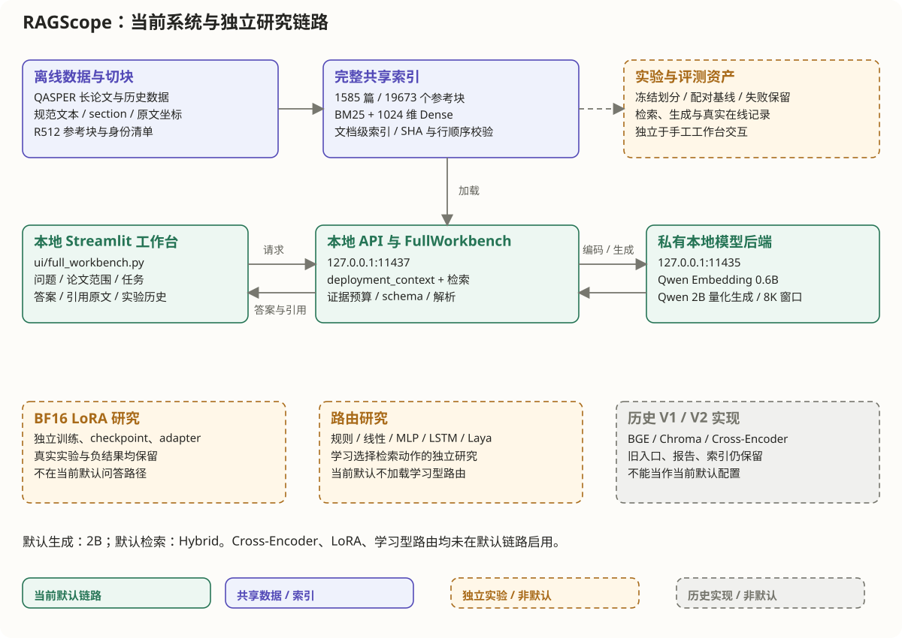

# RAGScope

**A local question-answering and evaluation workbench for long research papers.**

RAGScope answers questions over 1,585 QASPER papers with a fully local pipeline: hybrid retrieval (BM25 + dense embeddings), evidence packing that keeps every passage traceable to its exact position in the original text, and citation-constrained generation with a small local model. Every request is logged with its actual model input, raw output and configuration, so a wrong answer can be traced to retrieval, packing or generation.

The project grew in three stages: a short-text retrieval benchmark (V1), controlled experiments on long papers (V2), and a full-corpus workbench (V3, October 2026). This README describes V3. The full technical and evidence handbook (in Chinese) is [`docs/architecture.md`](docs/architecture.md).



---

## What V3 does

| Capability | Implementation |
|---|---|
| Corpus | 1,585 QASPER papers, 19,673 structure-aware chunks; text normalised (NFC) with section and character offsets preserved |
| Scope | Ask across the whole corpus, within one paper, or across several selected papers; answer modes: auto, fact, explanation, comparison, summary |
| Retrieval | Compressed BM25 (SciPy CSC sparse matrix) + 1,024-d Qwen3-Embedding-0.6B vectors (NumPy memory-mapped, exact search), fused with weighted RRF |
| Evidence packing | Projection back to original offsets, de-duplication, neighbour expansion and a token budget (2,048 reference tokens for ordinary QA; 6,144 for summary and comparison) |
| Generation | Qwen3.5-2B (Q4_K_M) served by a private local Ollama backend, 8K context kept resident; JSON-schema output with citation IDs restricted to the supplied evidence |
| Traceability | Per-request JSONL ledger (actual input, raw response, config hash, errors); answers, citations and the full evidence shown in the Streamlit workbench; history replay |
| Privacy | No cloud API and no automatic downloads at query time |

Cross-encoder reranking, learned routing and the LoRA adapter were implemented and tested, but are **off by default** because they did not show a stable benefit (see below).

---

## Results

All comparisons use fixed question sets and identical conditions; failed generations stay in the denominator. Paper-level cluster bootstrap (2,000 resamples) was used for V2 analyses.

| Experiment | Result | Notes |
|---|---|---|
| Structure-aware vs simple chunking (V2, 100 questions, 92 answerable) | Answer token F1 of the 2B model **0.443 → 0.484** | Local observation on this subset |
| Final deployment vs ported V2 baseline (H_QA200, 170 answerable) | Token F1 **0.390 → 0.407**; 25 better, 17 worse, 128 unchanged | Small, descriptive improvement |
| Task-aware evidence for summary/comparison (20 tasks) | Annotated key points reaching the context **57% → 100%**; F1 **0.427 → 0.458** | References are AI-constructed and quote-verified, not human-reviewed; whole deployment strategy compared |
| Reranking funnel (100 held-out questions) | Fully packed evidence **0.79 (hybrid) → 0.65 (BGE reranker)**, while candidate coverage stays 1.0 | Reordering pushed needed passages out of the fixed budget → reranking disabled |
| Model scale (V2, 200 questions × 4 retrieval settings) | Hybrid-retrieval F1: 2B 0.482, 4B 0.379, 9B 0.333 | Protocol-dependent (answer length, templates, quantisation); not a general claim about model size |
| Online latency (30 warm requests) | Fixing model reloads caused by 4K/8K window switching: P95 **10.13 s → 1.99 s** | Still slower than the same-round baseline (P95 1.48 s, 4K window) |
| LoRA on Qwen3.5-2B (BF16, 972 samples, r = 8, 122 steps) | Same-precision 100-question F1 **0.465 → 0.427**; more refusals, slower | Adapter kept for analysis, not loaded by default |

### Known limitations

- **Abstention is weak**: only 3 of 30 unanswerable questions were correctly refused.
- **Whole-corpus retrieval is hard**: without a paper scope, hybrid full-evidence coverage is 0.18 and document Hit@10 is 0.38.
- **Factual correctness is not human-verified.** Citation validity does not imply factual support; the semantic score is an embedding cosine, not BERTScore.
- The API is a local, single-user standard-library HTTP server (loopback only, no authentication or concurrency).
- The runtime was built on one Windows machine; models, indexes and environments live outside the repository and are not included.

---

## Running locally (Windows)

Prerequisites: a prepared runtime directory (`D:/RAGScope_Runtime`, created with `scripts/bootstrap_v2.ps1`), the local models listed in the handbook, the full index, and a GPU for generation. Detailed instructions, including how to shut services down cleanly, are in [`LOCAL_RUN_V3.md`](LOCAL_RUN_V3.md).

```powershell
# Terminal 1: check, then start the QA service (API on 127.0.0.1:11437)
. ./scripts/runtime_env.ps1
& D:/RAGScope_Runtime/envs/core/Scripts/python.exe scripts/v3/serve_full_workbench.py --check-only
& D:/RAGScope_Runtime/envs/core/Scripts/python.exe scripts/v3/serve_full_workbench.py

# Terminal 2: open the workbench (http://127.0.0.1:8502)
. ./scripts/runtime_env.ps1
./scripts/run_ui_v3.ps1
```

Unit tests do not download models or use the GPU:

```powershell
. ./scripts/runtime_env.ps1
& "$env:RAGSCOPE_HOME/envs/core/Scripts/python.exe" -m pytest tests/unit -q
```

---

## Repository layout

```
ragscope/            core library: ingestion, indexing, retrieval, generation, evaluation, routing, training
ragscope/v3/         full-corpus retrieval, evidence packing, deployment client, workbench service
scripts/v3/          V3 build, experiment and service entry points
ui/                  Streamlit workbench
configs/v3/          release pointer (configs/v3/default.json)
tests/               unit and regression tests
reports/v3/          final report, metric specification, error attribution
docs/architecture.md full architecture and evidence handbook (Chinese)
```

---

## Version history

| Version | Focus | Note |
|---|---|---|
| V1 (May 2026) | Retrieval benchmark on SQuAD passages and arXiv abstracts: BGE-small + Chroma, BM25, RRF, BGE reranker | Hybrid Recall@10 of 0.95 on 200 queries is a **retrieval recall** on short texts, not answer accuracy |
| V2 | QASPER long papers: structure-aware chunking, original-text offsets, local 2B/4B/9B generation, routing and LoRA studies | 5,520 logged generations across 39 conditions (32 failures kept) |
| V3 (Oct 2026) | Full 1,585-paper index, scoped QA workbench, task-aware evidence, resident 8K backend | Current version |

---

## 中文简介

RAGScope 是一个在本地运行的长论文问答与评测平台。V3 覆盖 1,585 篇 QASPER 论文(19,673 个结构块),支持全库、单篇和多篇范围问答:检索融合压缩 BM25 与 1,024 维 Qwen 向量(加权 RRF),证据按原文坐标投影、去重并控制 token 预算,由本地量化的 Qwen3.5-2B 生成带引用的回答,每次请求的实际输入、原始输出和配置都记入账本。

项目的重点是受控评测:把检索覆盖、实际送入模型的证据、答案质量、拒答和耗时分开评估。重排、学习路由和 LoRA 都实现并测试过,但在已测条件下没有稳定收益,所以默认关闭。完整的架构说明与证据手册见 [`docs/architecture.md`](docs/architecture.md)。
