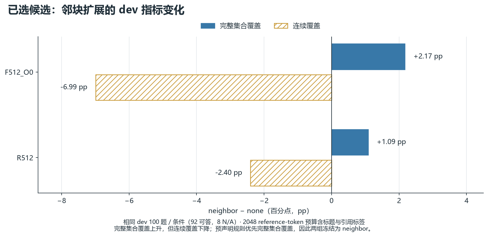
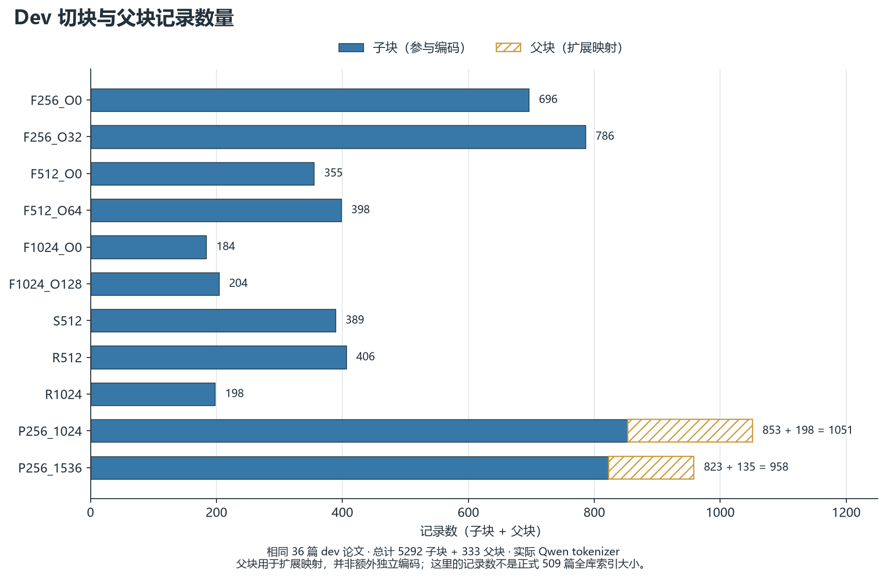
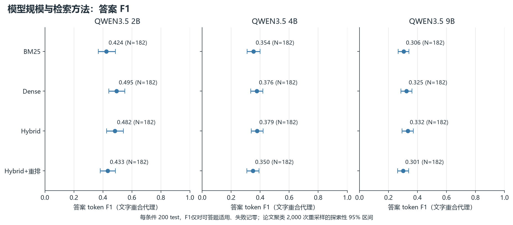
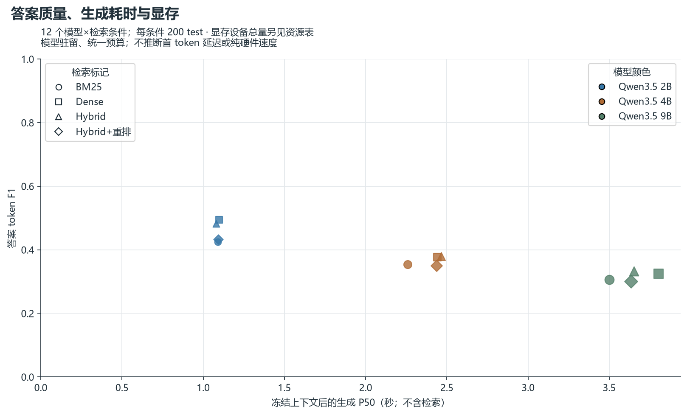
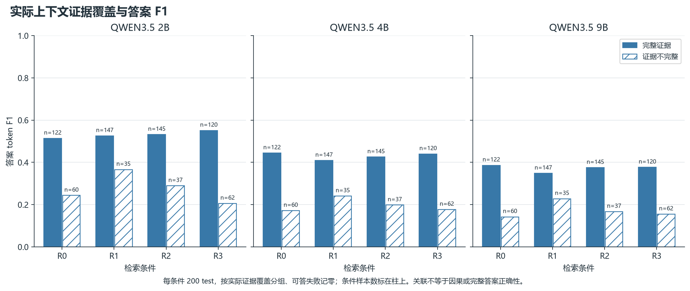
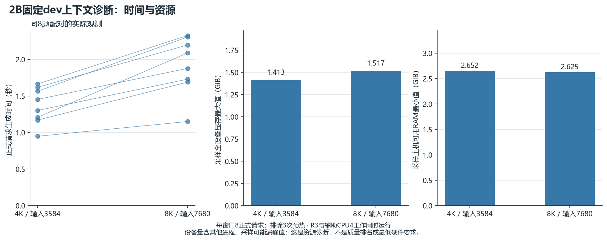
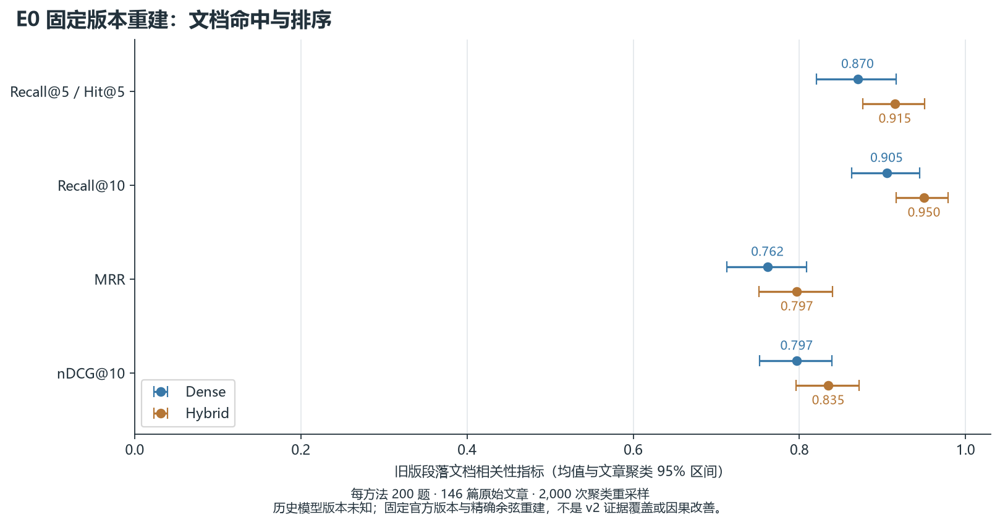
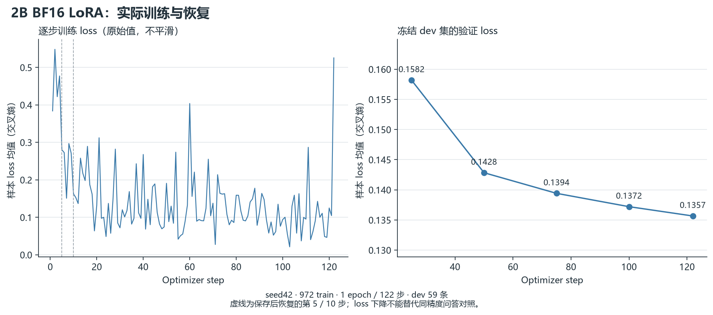

# RAGScope v2 最终实验报告

## 主要结论与交付入口

完整主矩阵5,520条、39组，32条解析失败保留；E2的2,400条与E3的1,200条没有请求错误。QASPER共509篇，训练/dev/test问答分别1,000/100/200，独立SQuAD为100题。答案文字重合F1、引用可见性和支持性模型分数都是代理指标，人类语义审核仍为NOT_REVIEWED。

E2固定Hybrid/neighbor的可回答F1为qwen_2b 0.482158、qwen_4b 0.378982、qwen_9b 0.332486（各182个适用问题）。本次协议下较大模型没有更高文字重合均值；这不等于普遍语义能力结论。默认2B/固定Hybrid/neighbor由dev预先选定，未因test结果改默认。

同100题BF16配对中，LoRA前后F1为0.464889→0.426683，生成P50为6.194→22.401秒；失败1→2条、错误拒答0→23条。引用可见率前后分母87/72不同，不能宣称faithfulness提高。保留原默认、不增加重训。两条件都是prompt-only，不能与主Q4 JSON-schema条件混算微调收益。

真实CPU检索/GPU生成在线各30题、共60题另6次预热：固定Hybrid P50 1.277657秒，规则1.213204秒，提速5.0446%，未达10%工程门槛，所以自适应路由保持禁用。学习router实际训练和Laya1,080条概率/3次预热均完成，但不据接口或概率认定质量收益。train/dev标签分布不同，训练准确率差距不能单独证明过拟合。第一次3次预热在推理前被设备策略拒绝，全部保留并计预算。

最终浏览器完成两条真实问答、5条可见引用检查、空问题拒绝、资源页和历史回放；这是功能实测，不是额外benchmark。正式UI配置已发布。所有本项目GPU/CPU/UI服务与锁已释放；设备只观测到Codex既有12MiB，原训练遵循USER_MANUAL_RESUME，由用户自行续跑，未自动重启。历史配对OS退出码UNKNOWN，完整独立审计实际exit0，不虚构历史exit0。

当前220份Python源前后哈希稳定，完整回归去重711PASS/1 Windows symlink权限skip；真实模型集成用逐行实验、在线与UI凭据单列。预算最终6,261/10,000张预留票包含预热、失败和推理前拒绝，不能当作6,261次成功模型推理。

子报告：[检索与切块](RETRIEVAL_TABLES.md)、[模型与资源](RESOURCE_REPORT.md)、[真实路由](ROUTING_REPORT.md)、[LoRA训练与配对](TRAINING_REPORT.md)。[错误案例](ERROR_CASES.md)保留失败类别与适用范围；完整22MB错误账本在项目本地保留，轻量包可追溯投影保留全部任务与失败分母。启动命令见项目根目录LOCAL_RUN_V2.md；八份中文学习说明见docs/learning。

E0旧embedding原始版本UNKNOWN，只算固定官方版本重建。R3的CPU300条与GPU360条采用不同设备/Transformers后端，29条历史CPU局部记录保留不合并；部分CPU/GPU运行重叠，计时和设备总显存不等于独占硬件保证。WSL内存上限未改，未安装项目WSL模型环境；C/D整盘变化包含其他程序与系统活动，不能声称C盘零写入。最终存储与原件保护见ACCEPTANCE.json的第3/14项。


生成于 2026-10-14T09:12:02.237998+00:00。本次清单包含 E2, E3, E4, E5, E6, E7, ROUTE_DEV, ROUTE_TRAIN，该清单的真实实验汇总状态：**COMPLETE**。
本报告由逐行记录及不可变来源重建，验收结论另见 ACCEPTANCE.json；本报告生成成功不代表十五项验收全部通过。

## 任务与实际环境

目标是在英文公开资料上比较切块、检索、上下文、模型规模、路由及有限LoRA。界面和讲解使用中文；中文边界夹具只验证文本处理，不是中文问答质量基准。
环境体检记录：Windows-11-10.0.26200-SP0；Python 3.12.13；32 个逻辑CPU；物理内存 15.28 GiB。
GPU体检原文：
```text
index, name, uuid, memory.total [MiB], memory.used [MiB], memory.free [MiB], driver_version
0, NVIDIA GeForce RTX 5060 Laptop GPU, GPU-5aa8b416-b762-d174-471c-35185090302b, 8151 MiB, 688 MiB, 7212 MiB, 595.79
```

隔离环境、模型、语料、缓存、索引、日志和断点使用 D:/RAGScope_Runtime。CPU计算显式4线程与空CUDA掩码；用户后续授权任何阶段使用GPU，新GPU计算单独绑定设备/后端，较早12线程历史耗时不能改写为4线程实测。

## 数据与工程修复

QASPER 的实际冻结人群：`{"train": {"n": 1000, "answerable": 869, "unanswerable": 131}, "dev": {"n": 100, "answerable": 92, "unanswerable": 8}, "test": {"n": 200, "answerable": 182, "unanswerable": 18}}`；来源 `D:\RAGScope_Runtime\corpora\20261014_v2\SPLIT_MANIFEST.json`。
SQuAD E4 的实际冻结人群：`{"test": {"n": 100, "answerable": 100, "unanswerable": 0}}`；来源 `D:\RAGScope_Runtime\corpora\20261014_v2\squad_e4\SPLIT_MANIFEST.json`。

保留规范文本坐标、证据参考集合及真实不可回答标签。多标注冲突隔离并保留来源，论文在train/dev/test之间互斥；SQuAD按原始文章聚类，不把同文多题当成独立来源。
索引与缓存绑定数据、切块、tokenizer、embedding、query指令和配置身份。完整文本用包含query的512-token窗口进行BGE重排；论文块不足50时显式保存短缺，不复制候选补数。
simple只为固定test论文编码，仍保留全509篇的BM25统计。长块、overlap、父子关系及证据映射有性质测试；原旧索引和报告保留独立hash核验。

## 实验协议与完整结果

E1用同一CPU embedding进行dev选型；E2为三主模型×四检索方法×200test；E3为相同test的Oracle和No Context；E4为独立SQuAD100；E5为LFM两路径100；E6为两个模型的简单/结构切块100；E7为生成前固定的证据位置诊断；E8为100题全库检索，不额外调用生成器。ROUTE的200train/60dev三路径用于真实代理标签。实际N与阻断以冻结清单和下表为准。
主生成统一greedy、512输出上限、关闭thinking、Q4_K_M及各自核验过的聊天模板。所有主模型收到同一重打包上下文，同时检查2048参考预算和各真实模型窗口；实际prompt token数与参考token数单列。
引用ID受可见上下文的JSON schema enum约束，因此合法ID率是工程性质，不能视为事实支持性改善。

### E1：已完成的dev切块与上下文结果

预声明的 Hybrid 选择规则冻结了简单候选 **F512_O0** 和结构候选 **R512**，两者均采用邻块扩展。邻块扩展提高了完整参考证据集合覆盖，同时降低了连续证据覆盖；下面同时呈现两项指标。

这是 dev 选型报告。主矩阵 33 个条件，扩展诊断 8 个条件，共 4,100 条逐条件记录、0 失败；全部反复使用相同的 100 个问题、36 篇论文，不是 4,100 个独立问题。每条件 92 个可答题计入证据均值，8 个不可答题为 N/A。未纳入 test、全库未完成运行、R3 重排或生成模型结果。

## 检索方法与切块


所有 Dense/Hybrid 条件使用同一实际 Qwen3-Embedding-0.6B Q8_0 CPU 模型、相同 query 指令和目标 tokenizer，reference context 预算固定为 2048（包含标题与引用标签）。图中父子组先按 child 排序，再扩展 parent；其他组的主矩阵使用 none。

P256_1024 的 Dense 完整集合覆盖为 0.804348，高于其 Hybrid 的 0.728261。候选选择按实验前约定的 Hybrid 指标进行，因此保留 R512；没有事后改成选择最高的单个 Dense 单元。这里是描述性 dev 比较，未作显著性或 test 泛化结论。

## 邻块扩展的取舍



| 候选 | 完整集合覆盖 none → neighbor | 连续覆盖 none → neighbor |
|---|---:|---:|
| F512_O0 | 0.663043 → 0.684783（+2.17 pp） | 0.777828 → 0.707951（−6.99 pp） |
| R512 | 0.739130 → 0.750000（+1.09 pp） | 0.779438 → 0.755435（−2.40 pp） |

冻结规则先比较完整集合覆盖，再比较连续覆盖，容差 0.01 是工程选择容差，不是显著性阈值。这里完整集合覆盖增量略大于该容差，所以选择 neighbor；不能称为所有证据指标均有提升。

同题配对计数揭示了均值背后的替换：

| 候选 / 指标 | 改善题数 | 退步题数 | 不变题数 |
|---|---:|---:|---:|
| F512_O0 / 完整集合覆盖 | 16 | 14 | 62 |
| F512_O0 / 连续覆盖 | 16 | 19 | 57 |
| R512 / 完整集合覆盖 | 8 | 7 | 77 |
| R512 / 连续覆盖 | 8 | 8 | 76 |

每行分母均为92，可答题之外的8题仍是N/A。R512的完整覆盖不是只有一题变化，而是8题改善、7题退步，净增1题。该指标的单题均值步长是1/92≈0.01087，略大于预声明的0.01容差；因此一题净增就足以影响选型，这不能当作统计显著性证据。配对明细冻结于`analysis_complete_dev/EXPANSION_PAIRED_CHANGES.json`，无新增模型调用。

## 切块记录量



11 组共有 5,292 个 child 和 333 个 parent 记录。父块用于扩展映射，没有作为新增独立输入重复编码。这些数量只覆盖相同的 36 篇 dev 论文，不是正式 509 篇全库索引大小。构块耗时、正文 token 分布及原始参数保存在 SOURCE_SNAPSHOT.json，构块耗时不包含模型编码。

## 核验与复现

逐条原始记录和配置 hash、固定 dev ID 集合、16,412 个 context 原文片段全部核验。独立区间合并实现从 canonical 源坐标重算了 123 个汇总数字，并按 seed42 抽取 10 个数字单列如下。没有用汇总表反证汇总表，也没有将历史缺失的 backend token 用量补造出来。

| 运行 | 指标 | 独立求和 / 92 | 重算值 | 原始汇总 |
|---|---|---:|---:|---:|
| E1_P256_1536_bm25_parent | full_reference_coverage | 51.000000000 / 92 | 0.554347826 | 0.554347826 |
| E1_F1024_O128_dense_none | continuous_coverage | 59.117102389 / 92 | 0.642577200 | 0.642577200 |
| E1_F1024_O0_dense_none | full_reference_coverage | 56.000000000 / 92 | 0.608695652 | 0.608695652 |
| E1_R1024_dense_none | full_unit_recall | 65.100000000 / 92 | 0.707608696 | 0.707608696 |
| E1_F256_O32_hybrid_none | continuous_coverage | 71.164111013 / 92 | 0.773522946 | 0.773522946 |
| E1_F256_O32_dense_none | full_unit_recall | 64.208333333 / 92 | 0.697916667 | 0.697916667 |
| E1_F256_O32_bm25_none | full_unit_recall | 59.433333333 / 92 | 0.646014493 | 0.646014493 |
| E1_F1024_O128_hybrid_none | continuous_coverage | 62.496164979 / 92 | 0.679306141 | 0.679306141 |
| E1_F1024_O128_dense_none | full_unit_recall | 55.125000000 / 92 | 0.599184783 | 0.599184783 |
| E1_P256_1536_dense_parent | continuous_coverage | 60.933333333 / 92 | 0.662318841 | 0.662318841 |

原始、不可变分析快照：`D:/RAGScope_Runtime/runs/20261014_v2_retrieval/analysis_complete_dev/SOURCE_SNAPSHOT.json`。SHA-256：`eb7de862fe1603e18cbea2a26459560d3aed4e818d7aafa6a34180fe61633429`。逐图数据、PNG/SVG、图表设计、图像/数据清单均在本目录。图表不包含缓存命中查询与冷编码混合的延迟排名；真实在线端到端延迟由后续专门实验核验。

复现命令（保留原快照并验证其全部源 hash）：

```powershell
. ./scripts/runtime_env.ps1
& 'D:/RAGScope_Runtime/envs/reports/Scripts/python.exe' -u reports/v2/retrieval_interim/build_dev_figures.py --home D:/RAGScope_Runtime --campaign 20261014_v2
```


### 冻结模型身份

|模型ID|实际本地模型tag|量化|后端版本|
|---|---|---|---|
|lfm|liquidai/lfm2.5-1.2b-instruct:q4_k_m|Q4_K_M|0.34.4|
|qwen_2b|ragscope-qwen3.5:2b-q4_K_M|Q4_K_M|0.34.4|
|qwen_4b|ragscope-qwen3.5:4b-q4_K_M|Q4_K_M|0.34.4|
|qwen_9b|ragscope-qwen3.5:9b-q4_K_M|Q4_K_M|0.34.4|

权重、revision/本地manifest和模板身份：

- `lfm`：weight SHA `b1b3de114215d9507409a662a501a631095a479a419584e8a2ded6304b19b4f5`；revision `120c341e628189e9968d6e081b7dc2f94580a17a0d7f5c9f259f237d9ddd11c9`；template SHA `b24cef34023c7219d9e8ed2d3b1b4a09788d6a6b4e3244774b135e152a79e239`。
- `qwen_2b`：weight SHA `20cb277f0967ace47b0b5d5658e5e494a88937f7378b74b5a266496400938f4c`；revision `7220c13501f593fcb95cc95580b7dd7b3ae5b1ae14669525b3e0641edb701424`；template SHA `9dab317a59a960c63eb77a2bffbe88aa86c9774c13bc4b51f2af993481efe48b`。
- `qwen_4b`：weight SHA `a9d0a3e1d8c91732a3812becd31f8d4a8ff57414903f226306069f0437e2ac50`；revision `6618472409bfe4b0a93751a47281cc60ede08def3b02bed994d9ad9e929c326a`；template SHA `5fa55f1b2834ab626a7abb83e7b51a3764dd104c2fb9923cec514b4cb545b5bf`。
- `qwen_9b`：weight SHA `02d45dc1cf451ba2475ac33b301c2dd8f985abe4c182ce04a1f2f5bf0260278d`；revision `5bca1ea588fcef5d62b567541a5326d1aaf5315c324854de8a5017b9a02d8e32`；template SHA `5fa55f1b2834ab626a7abb83e7b51a3764dd104c2fb9923cec514b4cb545b5bf`。

Qwen与LFM的模型结构、模板和tokenizer不同，异构对照单独报告。LFM许可限制见固定模型包来源/模型卡，本轮是本地个人研究，不声称商业部署许可。

# RAGScope v2 逐行生成结果重建

状态：**COMPLETE**。已记录 5520 / 5520 个可运行任务；另有 0 个任务明确受阻。

下表 F1 只对可回答问题适用，失败记零；不可回答问题单列拒答指标。证据覆盖衡量实际发送的上下文，不能称为事实支持性。

|实验|模型|方法|状态|已记录/计划|失败|文字 F1|完整证据覆盖|生成 P50 ms|
|---|---|---|---|---:|---:|---:|---:|---:|
|E2|qwen_2b|R0|COMPLETE|200/200|0|0.4244|0.6703|1090.2930|
|E2|qwen_2b|R1|COMPLETE|200/200|0|0.4947|0.8077|1098.0783|
|E2|qwen_2b|R2|COMPLETE|200/200|0|0.4822|0.7967|1079.1408|
|E2|qwen_2b|R3|COMPLETE|200/200|0|0.4332|0.6593|1092.8351|
|E2|qwen_4b|R0|COMPLETE|200/200|0|0.3542|0.6703|2259.4379|
|E2|qwen_4b|R1|COMPLETE|200/200|0|0.3765|0.8077|2441.7370|
|E2|qwen_4b|R2|COMPLETE|200/200|0|0.3790|0.7967|2463.7906|
|E2|qwen_4b|R3|COMPLETE|200/200|0|0.3501|0.6593|2435.6174|
|E2|qwen_9b|R0|COMPLETE|200/200|0|0.3057|0.6703|3499.2146|
|E2|qwen_9b|R1|COMPLETE|200/200|0|0.3248|0.8077|3802.2732|
|E2|qwen_9b|R2|COMPLETE|200/200|0|0.3325|0.7967|3651.8319|
|E2|qwen_9b|R3|COMPLETE|200/200|0|0.3009|0.6593|3633.6108|
|E3|qwen_2b|no_context|COMPLETE|200/200|0|0.0415|0.0000|499.0682|
|E3|qwen_2b|oracle|COMPLETE|200/200|0|0.5786|1.0000|846.6622|
|E3|qwen_4b|no_context|COMPLETE|200/200|0|0.0044|0.0000|488.0085|
|E3|qwen_4b|oracle|COMPLETE|200/200|0|0.5455|1.0000|1204.2622|
|E3|qwen_9b|no_context|COMPLETE|200/200|0|0.0000|0.0000|920.8531|
|E3|qwen_9b|oracle|COMPLETE|200/200|0|0.4705|1.0000|1773.7122|
|E4|qwen_2b|hybrid|COMPLETE|100/100|0|0.7474|0.9700|1054.2414|
|E4|qwen_4b|hybrid|COMPLETE|100/100|2|0.7606|0.9700|1911.0878|
|E4|qwen_9b|hybrid|COMPLETE|100/100|0|0.5473|0.9700|2841.8496|
|E5|lfm|bm25|COMPLETE|100/100|13|0.1971|0.6957|1340.7836|
|E5|lfm|hybrid|COMPLETE|100/100|16|0.1982|0.8043|1349.8997|
|E6|qwen_2b|simple|COMPLETE|100/100|1|0.4426|0.7065|1043.5559|
|E6|qwen_2b|structured|COMPLETE|100/100|0|0.4837|0.8043|1051.9059|
|E6|qwen_4b|simple|COMPLETE|100/100|0|0.4114|0.7065|2191.1698|
|E6|qwen_4b|structured|COMPLETE|100/100|0|0.4329|0.8043|2390.8032|
|E7|qwen_2b|end|COMPLETE|40/40|0|0.5876|1.0000|794.6764|
|E7|qwen_2b|middle|COMPLETE|40/40|0|0.5684|1.0000|792.5202|
|E7|qwen_2b|start|COMPLETE|40/40|0|0.5527|1.0000|778.7888|
|E7|qwen_4b|end|COMPLETE|40/40|0|0.5475|1.0000|1407.5028|
|E7|qwen_4b|middle|COMPLETE|40/40|0|0.5209|1.0000|1523.9832|
|E7|qwen_4b|start|COMPLETE|40/40|0|0.5138|1.0000|1469.1225|
|ROUTE_DEV|qwen_2b|bm25|COMPLETE|60/60|0|0.3806|0.6964|1075.3282|
|ROUTE_DEV|qwen_2b|hybrid|COMPLETE|60/60|0|0.4298|0.7500|1148.7480|
|ROUTE_DEV|qwen_2b|hybrid_rerank|COMPLETE|60/60|0|0.3710|0.6250|1049.9559|
|ROUTE_TRAIN|qwen_2b|bm25|COMPLETE|200/200|0|0.3233|0.6199|1056.5772|
|ROUTE_TRAIN|qwen_2b|hybrid|COMPLETE|200/200|0|0.3258|0.5965|1052.9970|
|ROUTE_TRAIN|qwen_2b|hybrid_rerank|COMPLETE|200/200|0|0.3141|0.5673|1052.7159|

同一篇论文/原始文章内的问题一起重采样，共 2,000 次。完整置信区间、按上下文长度分组、错误种类和所有探索性配对对照见同目录 ANALYSIS.json。
生成时间从冻结上下文开始计时，不含检索。非流式调用没有实测首 token 时间。未完成组不生成最终均值或置信区间。

配置哈希：`e5f0a821b7653bb6f8134d4d7972c5c32019099ac3cf827e6ba3a1d6b83115bc`；实验清单哈希：`ac56e65060b49d8d536fdaf1584727a1f0e736b4ab1266c1845c0c1d6383f07c`。


## 统计、长度与资源

论文/原始文章配对cluster bootstrap固定2000次、95%区间。多重对照全部标为探索性，不据未校正区间宣称显著或因果。完整区间、预声明对照及失败分母见 ANALYSIS.json。
质量采用文字重合F1及实际上下文证据覆盖；不可答F1和证据指标为N/A，拒答另算。请求失败留在适用质量分母并记零，同时提供成功条件统计。
|实验|模型|方法|实际输入token P50|decode token/s P50|采样设备显存GiB|服务树RSS GiB|
|---|---|---|---:|---:|---:|---:|
|E2|qwen_2b|R0|2132.5|125.81|1.415|1.035|
|E2|qwen_2b|R1|2152.0|122.28|1.415|1.041|
|E2|qwen_2b|R2|2136.5|122.11|1.415|1.042|
|E2|qwen_2b|R3|2136.0|123.80|1.415|1.039|
|E2|qwen_4b|R0|2132.5|73.31|2.829|1.184|
|E2|qwen_4b|R1|2152.0|73.31|2.829|1.176|
|E2|qwen_4b|R2|2136.5|73.47|2.829|1.193|
|E2|qwen_4b|R3|2136.0|73.06|2.829|1.171|
|E2|qwen_9b|R0|2132.5|48.32|5.097|1.224|
|E2|qwen_9b|R1|2152.0|48.64|5.097|1.204|
|E2|qwen_9b|R2|2136.5|48.48|5.097|1.210|
|E2|qwen_9b|R3|2136.0|48.56|5.097|1.221|
|E3|qwen_2b|no_context|130.0|115.74|1.404|1.062|
|E3|qwen_2b|oracle|305.0|115.01|1.404|1.150|
|E3|qwen_4b|no_context|130.0|74.91|2.822|1.405|
|E3|qwen_4b|oracle|305.0|77.38|2.822|1.431|
|E3|qwen_9b|no_context|130.0|46.87|5.088|1.458|
|E3|qwen_9b|oracle|305.0|50.82|5.097|1.458|
|E4|qwen_2b|hybrid|2225.0|138.80|1.415|1.017|
|E4|qwen_4b|hybrid|2225.0|69.73|2.833|1.241|
|E4|qwen_9b|hybrid|2225.0|50.04|5.095|1.202|
|E5|lfm|bm25|2156.0|195.93|0.913|0.579|
|E5|lfm|hybrid|2149.5|191.45|0.913|0.578|
|E6|qwen_2b|simple|2014.5|126.86|1.415|1.017|
|E6|qwen_2b|structured|2147.5|126.51|1.415|1.017|
|E6|qwen_4b|simple|2014.5|73.58|2.833|1.214|
|E6|qwen_4b|structured|2147.5|73.72|2.833|1.214|
|E7|qwen_2b|end|684.0|135.64|1.415|1.017|
|E7|qwen_2b|middle|684.0|129.03|1.415|1.017|
|E7|qwen_2b|start|684.0|124.42|1.415|1.017|
|E7|qwen_4b|end|684.0|76.62|2.833|1.217|
|E7|qwen_4b|middle|684.0|76.57|2.833|1.213|
|E7|qwen_4b|start|684.0|73.19|2.833|1.214|
|ROUTE_DEV|qwen_2b|bm25|2142.0|127.73|1.415|1.017|
|ROUTE_DEV|qwen_2b|hybrid|2151.0|127.35|1.415|1.017|
|ROUTE_DEV|qwen_2b|hybrid_rerank|2135.0|130.59|1.415|1.016|
|ROUTE_TRAIN|qwen_2b|bm25|2161.0|132.53|1.415|1.017|
|ROUTE_TRAIN|qwen_2b|hybrid|2153.5|134.37|1.415|1.017|
|ROUTE_TRAIN|qwen_2b|hybrid_rerank|2146.5|133.36|1.415|1.039|

### 按规范文档长度分组

短文≤512、中等513–4096、长文>4096参考tokens，按切块前文档定义；与收到的上下文长度分开。各小组为描述性统计，失败保留，未知长度显示unknown。

|实验|模型|方法|文档长度组|已记录N|F1适用N|失败|文字F1|生成P50 ms|
|---|---|---|---|---:|---:|---:|---:|---:|
|E2|qwen_2b|R0|medium|85|70|0|0.4842|1040.6025|
|E2|qwen_2b|R0|long|115|112|0|0.3870|1103.3411|
|E2|qwen_2b|R1|medium|85|70|0|0.5596|1093.5988|
|E2|qwen_2b|R1|long|115|112|0|0.4541|1098.7323|
|E2|qwen_2b|R2|medium|85|70|0|0.5305|1053.7208|
|E2|qwen_2b|R2|long|115|112|0|0.4519|1101.1217|
|E2|qwen_2b|R3|medium|85|70|0|0.5092|1057.1899|
|E2|qwen_2b|R3|long|115|112|0|0.3857|1116.0608|
|E2|qwen_4b|R0|medium|85|70|0|0.4047|2207.6612|
|E2|qwen_4b|R0|long|115|112|0|0.3226|2458.7674|
|E2|qwen_4b|R1|medium|85|70|0|0.4354|2237.0119|
|E2|qwen_4b|R1|long|115|112|0|0.3396|2512.2357|
|E2|qwen_4b|R2|medium|85|70|0|0.4371|2231.8606|
|E2|qwen_4b|R2|long|115|112|0|0.3427|2532.2206|
|E2|qwen_4b|R3|medium|85|70|0|0.4156|2150.8624|
|E2|qwen_4b|R3|long|115|112|0|0.3091|2502.0374|
|E2|qwen_9b|R0|medium|85|70|0|0.3212|3416.1866|
|E2|qwen_9b|R0|long|115|112|0|0.2961|3604.2854|
|E2|qwen_9b|R1|medium|85|70|0|0.3310|3586.9534|
|E2|qwen_9b|R1|long|115|112|0|0.3208|4167.1278|
|E2|qwen_9b|R2|medium|85|70|0|0.3481|3431.0926|
|E2|qwen_9b|R2|long|115|112|0|0.3227|3689.3193|
|E2|qwen_9b|R3|medium|85|70|0|0.3216|3574.5659|
|E2|qwen_9b|R3|long|115|112|0|0.2879|3774.2448|
|E3|qwen_2b|no_context|medium|85|70|0|0.0470|469.0351|
|E3|qwen_2b|no_context|long|115|112|0|0.0380|513.2443|
|E3|qwen_2b|oracle|medium|85|70|0|0.5678|806.4925|
|E3|qwen_2b|oracle|long|115|112|0|0.5853|900.2971|
|E3|qwen_4b|no_context|medium|85|70|0|0.0066|485.2472|
|E3|qwen_4b|no_context|long|115|112|0|0.0031|499.2486|
|E3|qwen_4b|oracle|medium|85|70|0|0.5822|1124.3365|
|E3|qwen_4b|oracle|long|115|112|0|0.5226|1377.5055|
|E3|qwen_9b|no_context|medium|85|70|0|0.0000|924.0775|
|E3|qwen_9b|no_context|long|115|112|0|0.0000|917.2044|
|E3|qwen_9b|oracle|medium|85|70|0|0.4619|1584.6855|
|E3|qwen_9b|oracle|long|115|112|0|0.4758|1960.3911|
|E4|qwen_2b|hybrid|short|100|100|0|0.7474|1054.2414|
|E4|qwen_4b|hybrid|short|100|100|2|0.7606|1911.0878|
|E4|qwen_9b|hybrid|short|100|100|0|0.5473|2841.8496|
|E5|lfm|bm25|medium|47|41|7|0.2186|1369.7860|
|E5|lfm|bm25|long|53|51|6|0.1797|1324.9654|
|E5|lfm|hybrid|medium|47|41|6|0.2054|1344.7465|
|E5|lfm|hybrid|long|53|51|10|0.1925|1353.3330|
|E6|qwen_2b|simple|medium|47|41|1|0.5407|1008.1442|
|E6|qwen_2b|simple|long|53|51|0|0.3638|1117.9595|
|E6|qwen_2b|structured|medium|47|41|0|0.5545|1017.1606|
|E6|qwen_2b|structured|long|53|51|0|0.4269|1132.5230|
|E6|qwen_4b|simple|medium|47|41|0|0.4748|1966.9456|
|E6|qwen_4b|simple|long|53|51|0|0.3605|2449.4117|
|E6|qwen_4b|structured|medium|47|41|0|0.4921|2078.9725|
|E6|qwen_4b|structured|long|53|51|0|0.3854|2474.5175|
|E7|qwen_2b|end|medium|15|15|0|0.6511|748.3125|
|E7|qwen_2b|end|long|25|25|0|0.5495|829.4432|
|E7|qwen_2b|middle|medium|15|15|0|0.6543|761.2812|
|E7|qwen_2b|middle|long|25|25|0|0.5169|847.4820|
|E7|qwen_2b|start|medium|15|15|0|0.6270|774.4701|
|E7|qwen_2b|start|long|25|25|0|0.5082|796.3317|
|E7|qwen_4b|end|medium|15|15|0|0.6083|1374.3835|
|E7|qwen_4b|end|long|25|25|0|0.5110|1411.3420|
|E7|qwen_4b|middle|medium|15|15|0|0.5382|1582.4560|
|E7|qwen_4b|middle|long|25|25|0|0.5106|1509.7310|
|E7|qwen_4b|start|medium|15|15|0|0.5610|1348.8942|
|E7|qwen_4b|start|long|25|25|0|0.4855|1536.4551|
|ROUTE_DEV|qwen_2b|bm25|medium|19|16|0|0.4707|1091.0331|
|ROUTE_DEV|qwen_2b|bm25|long|41|40|0|0.3445|1059.6233|
|ROUTE_DEV|qwen_2b|hybrid|medium|19|16|0|0.4671|1079.5259|
|ROUTE_DEV|qwen_2b|hybrid|long|41|40|0|0.4148|1178.8420|
|ROUTE_DEV|qwen_2b|hybrid_rerank|medium|19|16|0|0.4811|1048.5967|
|ROUTE_DEV|qwen_2b|hybrid_rerank|long|41|40|0|0.3269|1051.3152|
|ROUTE_TRAIN|qwen_2b|bm25|medium|59|48|0|0.3376|1087.4399|
|ROUTE_TRAIN|qwen_2b|bm25|long|141|123|0|0.3177|1053.3512|
|ROUTE_TRAIN|qwen_2b|hybrid|medium|59|48|0|0.3478|1068.7785|
|ROUTE_TRAIN|qwen_2b|hybrid|long|141|123|0|0.3171|1044.3334|
|ROUTE_TRAIN|qwen_2b|hybrid_rerank|medium|59|48|0|0.3222|1058.4589|
|ROUTE_TRAIN|qwen_2b|hybrid_rerank|long|141|123|0|0.3110|1048.6899|

### 失败分母、成功条件与不可答拒答

|实验|模型|方法|已记录/计划|成功N|可答适用N|总体F1|成功条件F1|拒答precision|拒答recall|拒答F1|
|---|---|---|---|---:|---:|---:|---:|---:|---:|---:|
|E2|qwen_2b|R0|200/200|200|182|0.4244|0.4244|0.4286|0.1667|0.2400|
|E2|qwen_2b|R1|200/200|200|182|0.4947|0.4947|0.5000|0.1111|0.1818|
|E2|qwen_2b|R2|200/200|200|182|0.4822|0.4822|0.5000|0.1111|0.1818|
|E2|qwen_2b|R3|200/200|200|182|0.4332|0.4332|0.2500|0.0556|0.0909|
|E2|qwen_4b|R0|200/200|200|182|0.3542|0.3542|0.4375|0.3889|0.4118|
|E2|qwen_4b|R1|200/200|200|182|0.3765|0.3765|0.6000|0.3333|0.4286|
|E2|qwen_4b|R2|200/200|200|182|0.3790|0.3790|0.5455|0.3333|0.4138|
|E2|qwen_4b|R3|200/200|200|182|0.3501|0.3501|0.4286|0.3333|0.3750|
|E2|qwen_9b|R0|200/200|200|182|0.3057|0.3057|0.4286|0.5000|0.4615|
|E2|qwen_9b|R1|200/200|200|182|0.3248|0.3248|0.6000|0.3333|0.4286|
|E2|qwen_9b|R2|200/200|200|182|0.3325|0.3325|0.3846|0.2778|0.3226|
|E2|qwen_9b|R3|200/200|200|182|0.3009|0.3009|0.4118|0.3889|0.4000|
|E3|qwen_2b|no_context|200/200|200|182|0.0415|0.0415|0.0793|0.7222|0.1429|
|E3|qwen_2b|oracle|200/200|200|182|0.5786|0.5786|0.7368|0.7778|0.7568|
|E3|qwen_4b|no_context|200/200|200|182|0.0044|0.0044|0.0885|0.9444|0.1619|
|E3|qwen_4b|oracle|200/200|200|182|0.5455|0.5455|0.7083|0.9444|0.8095|
|E3|qwen_9b|no_context|200/200|200|182|0.0000|0.0000|0.0900|1.0000|0.1651|
|E3|qwen_9b|oracle|200/200|200|182|0.4705|0.4705|0.6429|1.0000|0.7826|
|E4|qwen_2b|hybrid|100/100|100|100|0.7474|0.7474|0.0000|0.0000|0.0000|
|E4|qwen_4b|hybrid|100/100|98|100|0.7606|0.7761|0.0000|0.0000|0.0000|
|E4|qwen_9b|hybrid|100/100|100|100|0.5473|0.5473|0.0000|0.0000|0.0000|
|E5|lfm|bm25|100/100|87|92|0.1971|0.2266|0.0000|0.0000|0.0000|
|E5|lfm|hybrid|100/100|84|92|0.1982|0.2369|0.0000|0.0000|0.0000|
|E6|qwen_2b|simple|100/100|99|92|0.4426|0.4475|1.0000|0.2500|0.4000|
|E6|qwen_2b|structured|100/100|100|92|0.4837|0.4837|0.0000|0.0000|0.0000|
|E6|qwen_4b|simple|100/100|100|92|0.4114|0.4114|0.7143|0.6250|0.6667|
|E6|qwen_4b|structured|100/100|100|92|0.4329|0.4329|0.7500|0.3750|0.5000|
|E7|qwen_2b|end|40/40|40|40|0.5876|0.5876|0.0000|0.0000|0.0000|
|E7|qwen_2b|middle|40/40|40|40|0.5684|0.5684|0.0000|0.0000|0.0000|
|E7|qwen_2b|start|40/40|40|40|0.5527|0.5527|0.0000|0.0000|0.0000|
|E7|qwen_4b|end|40/40|40|40|0.5475|0.5475|0.0000|0.0000|0.0000|
|E7|qwen_4b|middle|40/40|40|40|0.5209|0.5209|0.0000|0.0000|0.0000|
|E7|qwen_4b|start|40/40|40|40|0.5138|0.5138|0.0000|0.0000|0.0000|
|ROUTE_DEV|qwen_2b|bm25|60/60|60|56|0.3806|0.3806|0.0000|0.0000|0.0000|
|ROUTE_DEV|qwen_2b|hybrid|60/60|60|56|0.4298|0.4298|0.0000|0.0000|0.0000|
|ROUTE_DEV|qwen_2b|hybrid_rerank|60/60|60|56|0.3710|0.3710|0.0000|0.0000|0.0000|
|ROUTE_TRAIN|qwen_2b|bm25|200/200|200|171|0.3233|0.3233|0.2500|0.0345|0.0606|
|ROUTE_TRAIN|qwen_2b|hybrid|200/200|200|171|0.3258|0.3258|0.2000|0.0345|0.0588|
|ROUTE_TRAIN|qwen_2b|hybrid_rerank|200/200|200|171|0.3141|0.3141|0.4000|0.0690|0.1176|

生成P50/P95从冻结上下文开始计时，不含检索；路由组件重放之和与真实在线总时间分开。非流式调用无实测首token，保持N/A。显存是整个设备的采样量，包含其他进程；采样可能漏瞬时峰值，不能写成模型最低显存。CPU并行任务和历史负载条件不同，耗时是各运行条件下的描述性观测。

## 路由与微调是否值得启用

路由只读取问题和用户选择的范围等可见元数据。训练标签来自同一最小模型的三条真实路径，F1差≤0.01时优先较低实测成本，其后才是证据覆盖。它是文字重合与成本的代理最优标签，不能称为真实任务最优。路由测试评测必须在七个策略的dev/test决策全部冻结后读取测试路径分数；train/dev训练入口不打开test journals。完整性校验及历史操作者工具曾接触测试摘要，未据此训练、调参或选择默认，不能声称所有操作者从未见过测试字段。
UI改变默认路径需要完整60dev质量下降≤0.01及至少30条真实在线P50改善≥10%，且实际部署条件吻合。未达门槛继续固定路径，不用test挑默认。
### BF16 LoRA训练

来源：`D:\RAGScope_Runtime\runs\20261014_v2_lora\train_2b_1024_seed42\training_result.json`。

```json
{
  "status": "TRAIN_LOOP_COMPLETE",
  "actual_optimizer_steps": 122,
  "best_dev_loss": 0.13566311013932197,
  "best_checkpoint_available": true,
  "seed": 42
}
```

### 相同BF16基础模型与adapter的100题对照

来源：`D:\RAGScope_Runtime\runs\20261014_v2_lora\train_2b_1024_seed42\paired_test100\SUMMARY.json`。

```json
{
  "status": "COMPLETE",
  "expected_n_per_condition": 100,
  "baseline": {
    "abstention": {
      "f1": 0.2222222222222222,
      "fn": 7,
      "fp": 0,
      "precision": 1.0,
      "recall": 0.125,
      "tp": 1
    },
    "citation_visible_rate": {
      "n_applicable": 87,
      "n_success_applicable": 87,
      "overall": 0.40229885057471265,
      "success_conditional": 0.40229885057471265
    },
    "exact_match": {
      "n_applicable": 92,
      "n_success_applicable": 91,
      "overall": 0.18478260869565216,
      "success_conditional": 0.18681318681318682
    },
    "has_citation": {
      "n_applicable": 100,
      "n_success_applicable": 99,
      "overall": 0.87,
      "success_conditional": 0.8787878787878788
    },
    "json_valid": {
      "n_applicable": 100,
      "n_success_applicable": 99,
      "overall": 0.99,
      "success_conditional": 1.0
    },
    "latency_ms": {
      "n": 100,
      "p50": 6194.456650002394,
      "p95": 14528.66489499538,
      "p99_exploratory": 17301.199145999115
    },
    "n_failed": 1,
    "n_success": 99,
    "n_total": 100,
    "rouge_l": {
      "n_applicable": 92,
      "n_success_applicable": 91,
      "overall": 0.4469545330734715,
      "success_conditional": 0.45186612134900417
    },
    "token_f1": {
      "n_applicable": 92,
      "n_success_applicable": 91,
      "overall": 0.4648885838066629,
      "success_conditional": 0.4699972495627801
    }
  },
  "adapted": {
    "abstention": {
      "f1": 0.1764705882352941,
      "fn": 5,
      "fp": 23,
      "precision": 0.11538461538461539,
      "recall": 0.375,
      "tp": 3
    },
    "citation_visible_rate": {
      "n_applicable": 72,
      "n_success_applicable": 72,
      "overall": 1.0,
      "success_conditional": 1.0
    },
    "exact_match": {
      "n_applicable": 92,
      "n_success_applicable": 90,
      "overall": 0.21739130434782608,
      "success_conditional": 0.2222222222222222
    },
    "has_citation": {
      "n_applicable": 100,
      "n_success_applicable": 98,
      "overall": 0.72,
      "success_conditional": 0.7346938775510204
    },
    "json_valid": {
      "n_applicable": 100,
      "n_success_applicable": 98,
      "overall": 0.98,
      "success_conditional": 1.0
    },
    "latency_ms": {
      "n": 100,
      "p50": 22400.814399999945,
      "p95": 29524.276089996416,
      "p99_exploratory": 63019.605800996724
    },
    "n_failed": 2,
    "n_success": 98,
    "n_total": 100,
    "rouge_l": {
      "n_applicable": 92,
      "n_success_applicable": 90,
      "overall": 0.421246476874812,
      "success_conditional": 0.4306075096942522
    },
    "token_f1": {
      "n_applicable": 92,
      "n_success_applicable": 90,
      "overall": 0.42668344370608163,
      "success_conditional": 0.43616529801066123
    }
  },
  "identity": {
    "backend": "transformers-local-bf16",
    "backend_version": "5.19.0",
    "model": "Qwen/Qwen3.5-2B",
    "peft": "0.21.2",
    "quantization": "BF16",
    "revision": "15852e8c16360a2fea060d615a32b45270f8a8fc",
    "tokenizer_template_hash": "e9cb98e65623809a8a297af444986a3b417ecae1a19d519c0952eb1192abc5c1",
    "torch": "2.9.1+cu128",
    "weight_sha256": "a73bb3300f23285d52f3f8b9cabc22badddd27c67e0432e1f10170cd8d369140"
  },
  "adapter": {
    "bytes": 14798456,
    "path": "D:\\RAGScope_Runtime\\runs\\20261014_v2_lora\\train_2b_1024_seed42\\checkpoints\\step-000122\\adapter\\adapter_model.safetensors",
    "sha256": "a532dc22942d84e4dceabacb64b936c191b37ebdfa9fda092f3f87464d0bbae4"
  }
}
```

两个BF16条件共用后端、模板、上下文和精度；prompt-only JSON与Q4主矩阵的schema约束不同，跨协议差异不能全部归因于精度或微调。训练loss下降本身不证明QA改善。
### 路由 fixed_bm25

组件计时重放：
```json
{
  "dev": {
    "answer_f1": 0.38059813407371934,
    "answer_f1_n": 56,
    "correct_abstention_rate": 0.0,
    "evidence_coverage": 0.7142857142857143,
    "evidence_n": 56,
    "failure_rate": 0.0,
    "fallback_rate": 0.0,
    "latency_kind": "component_replay_estimate",
    "n": 60,
    "p50_latency_s": 1.1151116500022908,
    "p95_latency_s": 1.6282162400053486,
    "unanswerable_n": 4,
    "wrong_abstain_rate": 0.0
  },
  "test": {
    "answer_f1": 0.45927637612782213,
    "answer_f1_n": 92,
    "correct_abstention_rate": 0.25,
    "evidence_coverage": 0.7264492753623187,
    "evidence_n": 92,
    "failure_rate": 0.0,
    "fallback_rate": 0.0,
    "latency_kind": "component_replay_estimate",
    "n": 100,
    "p50_latency_s": 1.1470904999969207,
    "p95_latency_s": 1.6358425350001198,
    "unanswerable_n": 8,
    "wrong_abstain_rate": 0.0
  }
}
```

### 路由 fixed_hybrid

组件计时重放：
```json
{
  "dev": {
    "answer_f1": 0.4297770459808614,
    "answer_f1_n": 56,
    "correct_abstention_rate": 0.0,
    "evidence_coverage": 0.7678571428571429,
    "evidence_n": 56,
    "failure_rate": 0.0,
    "fallback_rate": 0.0,
    "latency_kind": "component_replay_estimate",
    "n": 60,
    "p50_latency_s": 1.2175615000069229,
    "p95_latency_s": 2.0187355049974935,
    "unanswerable_n": 4,
    "wrong_abstain_rate": 0.0
  },
  "test": {
    "answer_f1": 0.48100564622994624,
    "answer_f1_n": 92,
    "correct_abstention_rate": 0.125,
    "evidence_coverage": 0.8344202898550727,
    "evidence_n": 92,
    "failure_rate": 0.0,
    "fallback_rate": 0.0,
    "latency_kind": "component_replay_estimate",
    "n": 100,
    "p50_latency_s": 1.155106149992207,
    "p95_latency_s": 1.646140055003889,
    "unanswerable_n": 8,
    "wrong_abstain_rate": 0.0
  }
}
```

### 路由 fixed_hybrid_rerank

组件计时重放：
```json
{
  "dev": {
    "answer_f1": 0.3709878185172398,
    "answer_f1_n": 56,
    "correct_abstention_rate": 0.0,
    "evidence_coverage": 0.6636904761904763,
    "evidence_n": 56,
    "failure_rate": 0.0,
    "fallback_rate": 0.0,
    "latency_kind": "component_replay_estimate",
    "n": 60,
    "p50_latency_s": 1.7289458500017645,
    "p95_latency_s": 2.5694622100005287,
    "unanswerable_n": 4,
    "wrong_abstain_rate": 0.017857142857142856
  },
  "test": {
    "answer_f1": 0.466470917139826,
    "answer_f1_n": 92,
    "correct_abstention_rate": 0.0,
    "evidence_coverage": 0.6793478260869565,
    "evidence_n": 92,
    "failure_rate": 0.0,
    "fallback_rate": 0.0,
    "latency_kind": "component_replay_estimate",
    "n": 100,
    "p50_latency_s": 15.210546750000503,
    "p95_latency_s": 41.47272339000045,
    "unanswerable_n": 8,
    "wrong_abstain_rate": 0.010869565217391304
  }
}
```

### 路由 rules

组件计时重放：
```json
{
  "dev": {
    "answer_f1": 0.4266600464928943,
    "answer_f1_n": 56,
    "correct_abstention_rate": 0.0,
    "evidence_coverage": 0.7678571428571429,
    "evidence_n": 56,
    "failure_rate": 0.0,
    "fallback_rate": 0.0,
    "latency_kind": "component_replay_estimate",
    "n": 60,
    "p50_latency_s": 1.2175700000025245,
    "p95_latency_s": 2.1283935350043968,
    "unanswerable_n": 4,
    "wrong_abstain_rate": 0.0
  },
  "test": {
    "answer_f1": 0.47726858618853835,
    "answer_f1_n": 92,
    "correct_abstention_rate": 0.125,
    "evidence_coverage": 0.8235507246376813,
    "evidence_n": 92,
    "failure_rate": 0.0,
    "fallback_rate": 0.0,
    "latency_kind": "component_replay_estimate",
    "n": 100,
    "p50_latency_s": 1.1632816500004992,
    "p95_latency_s": 2.640163419996462,
    "unanswerable_n": 8,
    "wrong_abstain_rate": 0.0
  }
}
```

### 路由 linear

组件计时重放：
```json
{
  "dev": {
    "answer_f1": 0.38059813407371934,
    "answer_f1_n": 56,
    "correct_abstention_rate": 0.0,
    "evidence_coverage": 0.7142857142857143,
    "evidence_n": 56,
    "failure_rate": 0.0,
    "fallback_rate": 0.0,
    "latency_kind": "component_replay_estimate",
    "n": 60,
    "p50_latency_s": 1.115862950000519,
    "p95_latency_s": 1.6289237350094472,
    "unanswerable_n": 4,
    "wrong_abstain_rate": 0.0
  },
  "test": {
    "answer_f1": 0.45927637612782213,
    "answer_f1_n": 92,
    "correct_abstention_rate": 0.25,
    "evidence_coverage": 0.7264492753623187,
    "evidence_n": 92,
    "failure_rate": 0.0,
    "fallback_rate": 0.0,
    "latency_kind": "component_replay_estimate",
    "n": 100,
    "p50_latency_s": 1.1478169499987416,
    "p95_latency_s": 1.636480885003766,
    "unanswerable_n": 8,
    "wrong_abstain_rate": 0.0
  }
}
```

### 路由 mlp

组件计时重放：
```json
{
  "dev": {
    "answer_f1": 0.38059813407371934,
    "answer_f1_n": 56,
    "correct_abstention_rate": 0.0,
    "evidence_coverage": 0.7142857142857143,
    "evidence_n": 56,
    "failure_rate": 0.0,
    "fallback_rate": 0.0,
    "latency_kind": "component_replay_estimate",
    "n": 60,
    "p50_latency_s": 1.1162504000003537,
    "p95_latency_s": 1.6294169800064984,
    "unanswerable_n": 4,
    "wrong_abstain_rate": 0.0
  },
  "test": {
    "answer_f1": 0.45927637612782213,
    "answer_f1_n": 92,
    "correct_abstention_rate": 0.25,
    "evidence_coverage": 0.7264492753623187,
    "evidence_n": 92,
    "failure_rate": 0.0,
    "fallback_rate": 0.0,
    "latency_kind": "component_replay_estimate",
    "n": 100,
    "p50_latency_s": 1.1481917500004784,
    "p95_latency_s": 1.6368927599953167,
    "unanswerable_n": 8,
    "wrong_abstain_rate": 0.0
  }
}
```

### 路由 lstm

组件计时重放：
```json
{
  "dev": {
    "answer_f1": 0.38059813407371934,
    "answer_f1_n": 56,
    "correct_abstention_rate": 0.0,
    "evidence_coverage": 0.7142857142857143,
    "evidence_n": 56,
    "failure_rate": 0.0,
    "fallback_rate": 0.0,
    "latency_kind": "component_replay_estimate",
    "n": 60,
    "p50_latency_s": 1.1167912500004604,
    "p95_latency_s": 1.6291659550010074,
    "unanswerable_n": 4,
    "wrong_abstain_rate": 0.0
  },
  "test": {
    "answer_f1": 0.45927637612782213,
    "answer_f1_n": 92,
    "correct_abstention_rate": 0.25,
    "evidence_coverage": 0.7264492753623187,
    "evidence_n": 92,
    "failure_rate": 0.0,
    "fallback_rate": 0.0,
    "latency_kind": "component_replay_estimate",
    "n": 100,
    "p50_latency_s": 1.1478909999987081,
    "p95_latency_s": 1.637080479999713,
    "unanswerable_n": 8,
    "wrong_abstain_rate": 0.0
  }
}
```

### 路由 laya

组件计时重放：
```json
{
  "dev": {
    "answer_f1": 0.4297770459808614,
    "answer_f1_n": 56,
    "correct_abstention_rate": 0.0,
    "evidence_coverage": 0.7678571428571429,
    "evidence_n": 56,
    "failure_rate": 0.0,
    "fallback_rate": 0.95,
    "latency_kind": "component_replay_estimate",
    "n": 60,
    "p50_latency_s": 1.899623250001241,
    "p95_latency_s": 2.7320483599969516,
    "unanswerable_n": 4,
    "wrong_abstain_rate": 0.0
  },
  "test": {
    "answer_f1": 0.47756361724443896,
    "answer_f1_n": 92,
    "correct_abstention_rate": 0.125,
    "evidence_coverage": 0.8235507246376813,
    "evidence_n": 92,
    "failure_rate": 0.0,
    "fallback_rate": 0.96,
    "latency_kind": "component_replay_estimate",
    "n": 100,
    "p50_latency_s": 1.883926300002713,
    "p95_latency_s": 2.380350539999381,
    "unanswerable_n": 8,
    "wrong_abstain_rate": 0.0
  }
}
```

### 真实在线配对验证与部署门槛

来源：`D:\RAGScope_Runtime\runs\20261014_v2_routing\online\SUMMARY.json`。

```json
{
  "status": "COMPLETE",
  "groups": {
    "fixed_hybrid": {
      "n_expected": 30,
      "n_generation_attempted": 30,
      "n_pending": 0,
      "n_pre_generation_failures": 0,
      "summary": {
        "answer_f1": 0.40883048555667845,
        "answer_f1_n": 26,
        "correct_abstention_rate": 0.0,
        "evidence_coverage": 0.6923076923076923,
        "evidence_n": 26,
        "failure_rate": 0.0,
        "fallback_rate": 0.0,
        "latency_kind": "actual_online",
        "n": 30,
        "p50_latency_s": 1.277656600002956,
        "p95_latency_s": 2.0265946050003545,
        "unanswerable_n": 4,
        "wrong_abstain_rate": 0.0
      }
    },
    "rules": {
      "n_expected": 30,
      "n_generation_attempted": 30,
      "n_pending": 0,
      "n_pre_generation_failures": 0,
      "summary": {
        "answer_f1": 0.411394588120781,
        "answer_f1_n": 26,
        "correct_abstention_rate": 0.0,
        "evidence_coverage": 0.6923076923076923,
        "evidence_n": 26,
        "failure_rate": 0.0,
        "fallback_rate": 0.0,
        "latency_kind": "actual_online",
        "n": 30,
        "p50_latency_s": 1.2132038999989163,
        "p95_latency_s": 2.201953934998164,
        "unanswerable_n": 4,
        "wrong_abstain_rate": 0.0
      }
    }
  },
  "deployment": {
    "actual_request_minimum_met": true,
    "default": "fixed",
    "deploy": false,
    "latency_ok": false,
    "note": "engineering_threshold_not_statistical_significance",
    "online_subset_quality_ok": true,
    "quality_ok": true,
    "quality_population": {
      "answerable_n": 56,
      "fixed_f1": 0.4297770459808614,
      "kind": "all_frozen_dev",
      "n": 60,
      "nonfixed_f1": 0.4266600464928943
    },
    "reason": "full_dev_quality_and_actual_paired_latency"
  },
  "stop_reason": null,
  "load_timings_ms": {
    "index_load_ms": 2882.769299998472,
    "reranker_load_ms": 28903.334800001176,
    "router_load_ms": 0.03300000389572233
  },
  "warmup_records": 6,
  "test_used": false,
  "note": "Measured host/device sampling is in individual records; no inferred layer offload."
}
```

## 错误分析与支持性代理

逐条错误、timeout、长度截断JSON及拒答均保留；没检到文档、漏证据、预算丢证据、排序噪音、证据齐但文字F1低、缺引用、无效JSON和资源错误分开。无法确认的语义原因标uncertain，不把低F1直接当作幻觉。
Oracle只提供已标注证据，证据覆盖1并不保证参考答案所有事实已在提示中。No Context作为独立诊断，其空上下文引用覆盖不适用；不能移除这类行来抬高总体成绩。
详细样例见 ERROR_CASES.md/JSON；导出的人工审核字段保持NOT_REVIEWED。自动支持性裁判是proxy，同模型自评偏差保留，不能称为人工真值或已核验幻觉率。
### 本地支持性proxy

来源：`D:\RAGScope_Runtime\runs\20261014_v2_generation_e2\support_judge\SUMMARY.json`。

```json
{
  "status": "COMPLETE",
  "n_expected": 200,
  "n_completed": 200,
  "n_pending": 0,
  "verdict_counts": {
    "abstention": 5,
    "partially_supported": 15,
    "supported": 98,
    "unknown": 1,
    "unsupported": 81
  },
  "n_actual_judge_calls": 200,
  "n_same_model_bias": 67,
  "n_failed_or_unassessable": 1,
  "interpretation": "Stratified sample only; unweighted rate is not population hallucination rate or human truth"
}
```

## 检索、资源诊断与部署证据

### E0官方版本重建（旧历史权重UNKNOWN）

来源：`D:\RAGScope_Runtime\runs\20261014_v2_legacy_reconstructed\E0_ARTICLE_CLUSTER_CI.json`。

```json
{
  "status": "COMPLETE",
  "query_count": 200,
  "n_article_clusters": 146,
  "n_resamples": 2000,
  "confidence": 0.95,
  "original_weight_revision": "UNKNOWN",
  "reconstruction_label": "legacy_reconstructed_fixed_revision",
  "groups": {
    "dense": {
      "descriptive_ci95": {
        "hit5": {
          "confidence": 0.95,
          "high": 0.9166666666666666,
          "low": 0.8203883495145631,
          "mean": 0.87,
          "method": "SQuAD_original_article_cluster_percentile_row_weighted_mean",
          "n_clusters": 146,
          "n_resamples": 2000,
          "n_rows": 200,
          "seed": 42
        },
        "mrr": {
          "confidence": 0.95,
          "high": 0.8086937141062455,
          "low": 0.7124093189268462,
          "mean": 0.7615595238095239,
          "method": "SQuAD_original_article_cluster_percentile_row_weighted_mean",
          "n_clusters": 146,
          "n_resamples": 2000,
          "n_rows": 200,
          "seed": 42
        },
        "ndcg10": {
          "confidence": 0.95,
          "high": 0.8393182953202406,
          "low": 0.7518007774305944,
          "mean": 0.7966956315256174,
          "method": "SQuAD_original_article_cluster_percentile_row_weighted_mean",
          "n_clusters": 146,
          "n_resamples": 2000,
          "n_rows": 200,
          "seed": 42
        },
        "recall10": {
          "confidence": 0.95,
          "high": 0.944701039761017,
          "low": 0.8629314049364811,
          "mean": 0.905,
          "method": "SQuAD_original_article_cluster_percentile_row_weighted_mean",
          "n_clusters": 146,
          "n_resamples": 2000,
          "n_rows": 200,
          "seed": 42
        },
        "recall5": {
          "confidence": 0.95,
          "high": 0.9166666666666666,
          "low": 0.8203883495145631,
          "mean": 0.87,
          "method": "SQuAD_original_article_cluster_percentile_row_weighted_mean",
          "n_clusters": 146,
          "n_resamples": 2000,
          "n_rows": 200,
          "seed": 42
        }
      },
      "n_failed": 0,
      "n_total": 200
    },
    "hybrid": {
      "descriptive_ci95": {
        "hit5": {
          "confidence": 0.95,
          "high": 0.9507389162561576,
          "low": 0.8762364450730787,
          "mean": 0.915,
          "method": "SQuAD_original_article_cluster_percentile_row_weighted_mean",
          "n_clusters": 146,
          "n_resamples": 2000,
          "n_rows": 200,
          "seed": 42
        },
        "mrr": {
          "confidence": 0.95,
          "high": 0.8398254963000386,
          "low": 0.7514556481621738,
          "mean": 0.7970119047619048,
          "method": "SQuAD_original_article_cluster_percentile_row_weighted_mean",
          "n_clusters": 146,
          "n_resamples": 2000,
          "n_rows": 200,
          "seed": 42
        },
        "ndcg10": {
          "confidence": 0.95,
          "high": 0.8714943335979984,
          "low": 0.7956055267646567,
          "mean": 0.8347330388197943,
          "method": "SQuAD_original_article_cluster_percentile_row_weighted_mean",
          "n_clusters": 146,
          "n_resamples": 2000,
          "n_rows": 200,
          "seed": 42
        },
        "recall10": {
          "confidence": 0.95,
          "high": 0.978731758939512,
          "low": 0.916256157635468,
          "mean": 0.95,
          "method": "SQuAD_original_article_cluster_percentile_row_weighted_mean",
          "n_clusters": 146,
          "n_resamples": 2000,
          "n_rows": 200,
          "seed": 42
        },
        "recall5": {
          "confidence": 0.95,
          "high": 0.9507389162561576,
          "low": 0.8762364450730787,
          "mean": 0.915,
          "method": "SQuAD_original_article_cluster_percentile_row_weighted_mean",
          "n_clusters": 146,
          "n_resamples": 2000,
          "n_rows": 200,
          "seed": 42
        }
      },
      "n_failed": 0,
      "n_total": 200
    }
  },
  "limitations": [
    "Original legacy relevance is paragraph-document hit, not v2 evidence coverage.",
    "Historical model weights are unknown; pinned reconstruction uses exact cosine instead of HNSW.",
    "Intervals describe two already observed runs, are not adjusted simultaneous intervals or causal improvements.",
    "Article mapping uses the preserved original train-v2.0.json snapshot, not a newly downloaded dataset.",
    "A cluster repeated in bootstrap keeps all its sampled questions together; statistic remains question-weighted."
  ]
}
```

### 检索统计

来源：`D:\RAGScope_Runtime\runs\20261014_v2_retrieval\RETRIEVAL_STATISTICS.json`。

```json
{
  "status": "PASS",
  "test_used_for_selection": false,
  "comparisons": {
    "global_hybrid_minus_bm25": {
      "classification": "exploratory",
      "id": "global_hybrid_minus_bm25",
      "left": [
        "structured",
        "hybrid"
      ],
      "metrics": {
        "continuous_coverage": {
          "confidence": 0.95,
          "contrast": "left_minus_right",
          "high": 0.10000724637681156,
          "low": -0.013408280150548192,
          "mean": 0.04033333333333333,
          "method": "paper_cluster_percentile",
          "n_clusters": 56,
          "n_resamples": 2000,
          "n_rows": 100,
          "seed": 42
        },
        "full_reference_coverage": {
          "confidence": 0.95,
          "contrast": "left_minus_right",
          "high": 0.088257134536983,
          "low": -0.02128231525966598,
          "mean": 0.03,
          "method": "paper_cluster_percentile",
          "n_clusters": 56,
          "n_resamples": 2000,
          "n_rows": 100,
          "seed": 42
        },
        "full_unit_recall": {
          "confidence": 0.95,
          "contrast": "left_minus_right",
          "high": 0.10000724637681156,
          "low": -0.013408280150548192,
          "mean": 0.04033333333333333,
          "method": "paper_cluster_percentile",
          "n_clusters": 56,
          "n_resamples": 2000,
          "n_rows": 100,
          "seed": 42
        }
      },
      "right": [
        "structured",
        "bm25"
      ],
      "status": "PASS",
      "task": "global"
    },
    "global_hybrid_minus_dense": {
      "classification": "exploratory",
      "id": "global_hybrid_minus_dense",
      "left": [
        "structured",
        "hybrid"
      ],
      "metrics": {
        "continuous_coverage": {
          "confidence": 0.95,
          "contrast": "left_minus_right",
          "high": 0.08890350877192975,
          "low": -0.04364194577352472,
          "mean": 0.02033333333333333,
          "method": "paper_cluster_percentile",
          "n_clusters": 56,
          "n_resamples": 2000,
          "n_rows": 100,
          "seed": 42
        },
        "full_reference_coverage": {
          "confidence": 0.95,
          "contrast": "left_minus_right",
          "high": 0.08002020202020191,
          "low": -0.05406633906633907,
          "mean": 0.01,
          "method": "paper_cluster_percentile",
          "n_clusters": 56,
          "n_resamples": 2000,
          "n_rows": 100,
          "seed": 42
        },
        "full_unit_recall": {
          "confidence": 0.95,
          "contrast": "left_minus_right",
          "high": 0.08890350877192975,
          "low": -0.04364194577352472,
          "mean": 0.02033333333333333,
          "method": "paper_cluster_percentile",
          "n_clusters": 56,
          "n_resamples": 2000,
          "n_rows": 100,
          "seed": 42
        }
      },
      "right": [
        "structured",
        "dense"
      ],
      "status": "PASS",
      "task": "global"
    },
    "paper_hybrid_minus_bm25": {
      "classification": "exploratory",
      "id": "paper_hybrid_minus_bm25",
      "left": [
        "structured",
        "hybrid"
      ],
      "metrics": {
        "continuous_coverage": {
          "confidence": 0.95,
          "contrast": "left_minus_right",
          "high": 0.1726591506847865,
          "low": 0.06602283427495292,
          "mean": 0.11433150183150183,
          "method": "paper_cluster_percentile",
          "n_clusters": 72,
          "n_resamples": 2000,
          "n_rows": 182,
          "seed": 42
        },
        "full_reference_coverage": {
          "confidence": 0.95,
          "contrast": "left_minus_right",
          "high": 0.1860496041563582,
          "low": 0.07367826345524828,
          "mean": 0.12637362637362637,
          "method": "paper_cluster_percentile",
          "n_clusters": 72,
          "n_resamples": 2000,
          "n_rows": 182,
          "seed": 42
        },
        "full_unit_recall": {
          "confidence": 0.95,
          "contrast": "left_minus_right",
          "high": 0.1726591506847865,
          "low": 0.06602283427495292,
          "mean": 0.11433150183150183,
          "method": "paper_cluster_percentile",
          "n_clusters": 72,
          "n_resamples": 2000,
          "n_rows": 182,
          "seed": 42
        }
      },
      "right": [
        "structured",
        "bm25"
      ],
      "status": "PASS",
      "task": "paper"
    },
    "paper_hybrid_minus_dense": {
      "classification": "exploratory",
      "id": "paper_hybrid_minus_dense",
      "left": [
        "structured",
        "hybrid"
      ],
      "metrics": {
        "continuous_coverage": {
          "confidence": 0.95,
          "contrast": "left_minus_right",
          "high": 0.03314601566098567,
          "low": -0.07063188848754284,
          "mean": -0.01730769230769231,
          "method": "paper_cluster_percentile",
          "n_clusters": 72,
          "n_resamples": 2000,
          "n_rows": 182,
          "seed": 42
        },
        "full_reference_coverage": {
          "confidence": 0.95,
          "contrast": "left_minus_right",
          "high": 0.0378429788484136,
          "low": -0.062164648910411624,
          "mean": -0.01098901098901099,
          "method": "paper_cluster_percentile",
          "n_clusters": 72,
          "n_resamples": 2000,
          "n_rows": 182,
          "seed": 42
        },
        "full_unit_recall": {
          "confidence": 0.95,
          "contrast": "left_minus_right",
          "high": 0.03314601566098567,
          "low": -0.07063188848754284,
          "mean": -0.01730769230769231,
          "method": "paper_cluster_percentile",
          "n_clusters": 72,
          "n_resamples": 2000,
          "n_rows": 182,
          "seed": 42
        }
      },
      "right": [
        "structured",
        "dense"
      ],
      "status": "PASS",
      "task": "paper"
    },
    "paper_structured_minus_simple_hybrid": {
      "classification": "exploratory",
      "id": "paper_structured_minus_simple_hybrid",
      "left": [
        "structured",
        "hybrid"
      ],
      "metrics": {
        "continuous_coverage": {
          "confidence": 0.95,
          "contrast": "left_minus_right",
          "high": 0.13766717250583574,
          "low": 0.04007023242620717,
          "mean": 0.08822963518319256,
          "method": "paper_cluster_percentile",
          "n_clusters": 72,
          "n_resamples": 2000,
          "n_rows": 182,
          "seed": 42
        },
        "full_reference_coverage": {
          "confidence": 0.95,
          "contrast": "left_minus_right",
          "high": 0.18079246303642263,
          "low": 0.07099547511312218,
          "mean": 0.12637362637362637,
          "method": "paper_cluster_percentile",
          "n_clusters": 72,
          "n_resamples": 2000,
          "n_rows": 182,
          "seed": 42
        },
        "full_unit_recall": {
          "confidence": 0.95,
          "contrast": "left_minus_right",
          "high": 0.17107317722901516,
          "low": 0.06676859318996416,
          "mean": 0.11997863247863248,
          "method": "paper_cluster_percentile",
          "n_clusters": 72,
          "n_resamples": 2000,
          "n_rows": 182,
          "seed": 42
        }
      },
      "right": [
        "simple",
        "hybrid"
      ],
      "status": "PASS",
      "task": "paper"
    }
  }
}
```

### R3 GPU执行迁移配置

来源：`D:\RAGScope_Runtime\runs\20261014_v2_retrieval\R3_GPU_MIGRATION.json`。

```json
{
  "status": "FROZEN_NOT_EXECUTED",
  "reason": "Explicit user GPU authorization; CPU runtime RAM guard after329; deadline-bound device migration",
  "cpu_groups_preserved": [
    {
      "n_failed": 0,
      "n_saved": 100,
      "run_id": "E1_R512_hybrid_rerank_neighbor"
    },
    {
      "n_failed": 0,
      "n_saved": 200,
      "run_id": "TEST_CONTEXT_R512_hybrid_rerank_neighbor"
    },
    {
      "n_failed": 0,
      "n_saved": 29,
      "run_id": "E8_R512_hybrid_rerank_neighbor"
    }
  ],
  "expected_gpu_rows": 360,
  "device": "cuda",
  "dtype": "torch.float32",
  "tf32": false,
  "backend": "transformers_sequence_classifier",
  "backend_versions": {
    "numpy": "2.5.4",
    "torch": "2.9.1+cu128",
    "transformers": "5.19.0"
  },
  "historical_extra_partial_calls": 29,
  "comparison_limit": "CPU TEST200 remains E2 input; full GPU global100 replaces partial CPU29 for global statistics. Routing CPU/GPU backend differences disclosed, never claim device equivalence."
}
```

### R3 GPU实际独立验收

来源：`D:\RAGScope_Runtime\runs\20261014_v2_retrieval\R3_GPU_COMPLETION_VALIDATION.json`。

```json
{
  "status": "PASS",
  "scope": "all_gpu_three_groups",
  "n_total": 360,
  "n_failed": 0,
  "worker_exited": true,
  "gpu_migration_complete": true
}
```

R3主E2上下文保持原CPU测试来源；后续GPU E8/ROUTE使用独立正式记录。相同固定权重仍有设备、Transformers后端版本及计时条件差异，GPU训练路径成本不能直接当作CPU在线部署延迟；启用默认路由仍以真实部署条件的在线dev门槛为准。
### 4K dev压力诊断

来源：`D:\RAGScope_Runtime\runs\20261014_v2_context_stress\SUMMARY_4096.json`。

```json
{
  "status": "COMPLETE",
  "window": 4096,
  "n_expected": 8,
  "n_observed": 8,
  "quality_ranking_eligible": false
}
```

### 8K dev压力诊断

来源：`D:\RAGScope_Runtime\runs\20261014_v2_context_stress\SUMMARY_8192.json`。

```json
{
  "status": "COMPLETE",
  "window": 8192,
  "n_expected": 8,
  "n_observed": 8,
  "quality_ranking_eligible": false
}
```

压力诊断只使用固定dev人群，不混入主质量排名。UI仅127.0.0.1，缺安装/评测项显示真实状态，不在打开页面时下载或默认Mock。最终浏览器/HTTP实测范围见终验凭据。
## 执行、恢复与已知限制

早期S1/S2按原CPU-only规则执行，S3/S4曾与尚未结束的S2重叠；随后用户明确允许任何阶段用GPU且无原GPU竞争。原阶段串行偏差与后续授权覆盖均在criterion14披露，不能把GPU记录改名为CPU实测。用户已停止原训练及定时检查，日更未操作。
原任务恢复遵循最新USER_MANUAL_RESUME：释放本项目模型、服务和锁后通知用户自行续跑，不自动重启原训练。WSL上限未改；外部主机重启原因UNKNOWN，本项目没有执行电脑或WSL重启。
系统后端曾更新，本轮恢复D盘项目专用固定版继续复用原模型；用户已允许必要时新版替代，真实迁移必须绑定新后端身份并披露可比性，不改旧实验身份。中断从RecordStore恢复，保留失败与预算票据，不重复已落盘题。真实生成调用上限10000，warmup、失败、UI、路由、LoRA与裁判均计入。
本报告不声称中文QA、人工幻觉审核、独占设备最低硬件要求或test选型收益。原旧embedding权重未知的E0只算固定官方版本重建，不是精确历史复现。

实际复算命令：
```powershell
& D:/RAGScope_Runtime/envs/core/Scripts/python.exe scripts/analyze_generation_v2.py --campaign D:/RAGScope_Runtime/runs/20261014_v2_generation --output reports/v2
& D:/RAGScope_Runtime/envs/core/Scripts/python.exe scripts/audit_final_report_v2.py --report reports/v2/FINAL_REPORT.md --campaign D:/RAGScope_Runtime/runs/20261014_v2_generation --analysis reports/v2/ANALYSIS.json --corpus D:/RAGScope_Runtime/corpora/20261014_v2 --output D:/RAGScope_Runtime/runs/20261014_v2/FINAL_REPORT_REVERSE_AUDIT.json
```

逐项命令、exit code、证据和限制见 ACCEPTANCE.json；从本报告表格抽取至少10数字独立回到原始结果，不拿报告验证报告。

## 结果图








## 本次报告来源

- `D:\MCS_26S1课程资料\个人项目\RAGScope\reports\v2\ANALYSIS.json` · SHA-256 `207c2fb8d4041a2d890acd5f82ab58070c184c35dfcb15c9eb73a836865938d1`
- `D:\RAGScope_Runtime\runs\20261014_v2_generation\EXPERIMENT_MANIFEST.json` · SHA-256 `034c2e1a7a364de2e084c44fe7b6b61655b1d7d92d0e5eef5b390308e5f8517f`
- `D:\RAGScope_Runtime\runs\20261014_v2_generation\FROZEN_INPUTS.json` · SHA-256 `9983da3c70a1f98d28b4e6a81f0f114ea7cc240684cf3251731472031b25cbe0`
- `D:\RAGScope_Runtime\runs\20261014_v2\environment.json` · SHA-256 `a2f55c10153c591627bd8879570e156ca26c1664642e363a6cf96b13d8ba5e1e`
- `D:\RAGScope_Runtime\corpora\20261014_v2\SPLIT_MANIFEST.json` · SHA-256 `901bb1485cc2490fac9f149e02b7f3b48f48e39e0b581852022390473634f5e8`
- `D:\RAGScope_Runtime\corpora\20261014_v2\squad_e4\SPLIT_MANIFEST.json` · SHA-256 `fe0242b2320eca641f65363514031ee1a9ae3b3d13174472ed8aee7d8cdb863f`
- `D:\MCS_26S1课程资料\个人项目\RAGScope\reports\v2\retrieval_interim\DEV_RESULTS.md` · SHA-256 `91c1c6aaf4dfd79c6fb4170b334e76090b61787956c2798ed79623bb277caf8a`
- `D:\MCS_26S1课程资料\个人项目\RAGScope\reports\v2\retrieval_interim\dev_evidence_matrix.png` · SHA-256 `0e21ae3f5339c4c0f3114194a315ed6d20018e1f2bdcd05292b6be5245df23e1`
- `D:\MCS_26S1课程资料\个人项目\RAGScope\reports\v2\figures\e1_dev_evidence_matrix.png` · SHA-256 `0e21ae3f5339c4c0f3114194a315ed6d20018e1f2bdcd05292b6be5245df23e1`
- `D:\MCS_26S1课程资料\个人项目\RAGScope\reports\v2\retrieval_interim\dev_expansion_delta.png` · SHA-256 `59d0dc5e46d8f8ea6079209f4239ecfc718b0c5297f067bacb168988806a8744`
- `D:\MCS_26S1课程资料\个人项目\RAGScope\reports\v2\figures\e1_dev_expansion_delta.png` · SHA-256 `59d0dc5e46d8f8ea6079209f4239ecfc718b0c5297f067bacb168988806a8744`
- `D:\MCS_26S1课程资料\个人项目\RAGScope\reports\v2\retrieval_interim\dev_chunk_counts.png` · SHA-256 `6d5961a4b0db46eb0c3e08d298f0fcc4f9653cf58527133135cd27bf3aec19e0`
- `D:\MCS_26S1课程资料\个人项目\RAGScope\reports\v2\figures\e1_dev_chunk_counts.png` · SHA-256 `6d5961a4b0db46eb0c3e08d298f0fcc4f9653cf58527133135cd27bf3aec19e0`
- `D:\RAGScope_Runtime\runs\20261014_v2_lora\train_2b_1024_seed42\training_result.json` · SHA-256 `a154622c7c23d656545050f16b92697481f3c50c13a5312fe101127614273aea`
- `D:\RAGScope_Runtime\runs\20261014_v2_lora\train_2b_1024_seed42\paired_test100\SUMMARY.json` · SHA-256 `c47d9fb6bcdf975c4f0219b33bc4b47bfa52dcd78de6dab9bf837c2a74df3de9`
- `D:\RAGScope_Runtime\runs\20261014_v2_routing\REPLAY_fixed_bm25.json` · SHA-256 `3d16bccf8483069874e8752f12db3018dad200b751afd67e52eb509b4911c1fd`
- `D:\RAGScope_Runtime\runs\20261014_v2_routing\REPLAY_fixed_hybrid.json` · SHA-256 `f92e0ece531a50da1e148a093983e25445d23d2e76b1a7c15f8daf1981b3f9d0`
- `D:\RAGScope_Runtime\runs\20261014_v2_routing\REPLAY_fixed_hybrid_rerank.json` · SHA-256 `f891838c87e164069960a2eae320bf63487328b532d660a4be2ad5fc86dcdebd`
- `D:\RAGScope_Runtime\runs\20261014_v2_routing\REPLAY_rules.json` · SHA-256 `5067a895914a32861e50e10d8b61beb614ce222c82818af915287991909a34c3`
- `D:\RAGScope_Runtime\runs\20261014_v2_routing\REPLAY_linear.json` · SHA-256 `794994e8cde1aac993c1dcff733c551a2448795a3844f218f7d28535ee16df96`
- `D:\RAGScope_Runtime\runs\20261014_v2_routing\REPLAY_mlp.json` · SHA-256 `bc2f26995ae6241cf855e24c03bac74fd00202041008e04f62f6d8debf8e9920`
- `D:\RAGScope_Runtime\runs\20261014_v2_routing\REPLAY_lstm.json` · SHA-256 `ddc11e0c2cb956317754a9126b7371148467ffca6c0d74ba687cc92bb7e36210`
- `D:\RAGScope_Runtime\runs\20261014_v2_routing\REPLAY_laya.json` · SHA-256 `195f8177441b717a7c2ee7489af2608ea02ff3710eb6768f6a577c9e2e853fe7`
- `D:\RAGScope_Runtime\runs\20261014_v2_routing\online\SUMMARY.json` · SHA-256 `d3fabde7044ecaf04c38dffbb9c763161c3d473ba00f92c0084de2c7df653378`
- `D:\RAGScope_Runtime\runs\20261014_v2_generation_e2\support_judge\SUMMARY.json` · SHA-256 `a9e10245fe7db39af277e8738736467690ade3bd220b5e0b568a5cd31ddd14f8`
- `D:\RAGScope_Runtime\runs\20261014_v2_legacy_reconstructed\E0_ARTICLE_CLUSTER_CI.json` · SHA-256 `a13dc3a38e0d0e325fd2589008116999e952d50e085d19fcd9ff8b36a9f35b76`
- `D:\RAGScope_Runtime\runs\20261014_v2_retrieval\RETRIEVAL_STATISTICS.json` · SHA-256 `c300b1480b3a7095430b5026b9241c3ce962fb08ddadf2fc45f2037d0f0cbbff`
- `D:\RAGScope_Runtime\runs\20261014_v2_retrieval\R3_GPU_MIGRATION.json` · SHA-256 `697ce7ac3e0c213072359f03232a3b81d5ca4d8e33f0b4907f7ce58af77bbc51`
- `D:\RAGScope_Runtime\runs\20261014_v2_retrieval\R3_GPU_COMPLETION_VALIDATION.json` · SHA-256 `b10cb5b52bb54606eada1fccfbedcb0a302c22a4bfdd6acd0c5f77563fbdef89`
- `D:\RAGScope_Runtime\runs\20261014_v2_context_stress\SUMMARY_4096.json` · SHA-256 `9928e5dacaa7a5e1c541ee1b26341388381a2c781e90b162239a45a7d12a7e2e`
- `D:\RAGScope_Runtime\runs\20261014_v2_context_stress\SUMMARY_8192.json` · SHA-256 `592a0b559abb4fcdb937741240bfd25d785e44f92b22484edbf9c6b073c3ddda`
- `D:\RAGScope_Runtime\runs\20261014_v2_legacy_reconstructed\figures\e0_reconstructed_retrieval.png` · SHA-256 `d810a7727b60906dc6b4a5e04f739e936758bd318b4f295dc26b7a460e9b9ef3`
- `D:\MCS_26S1课程资料\个人项目\RAGScope\reports\v2\figures\e0_reconstructed_retrieval.png` · SHA-256 `d810a7727b60906dc6b4a5e04f739e936758bd318b4f295dc26b7a460e9b9ef3`
- `D:\RAGScope_Runtime\runs\20261014_v2_lora\train_2b_1024_seed42\figures\lora_training_loss.png` · SHA-256 `cabd45af12e20a18ddc78ab7c7b2fc5fa9485aa58724e805a0f734ce07c05627`
- `D:\MCS_26S1课程资料\个人项目\RAGScope\reports\v2\figures\lora_training_loss.png` · SHA-256 `cabd45af12e20a18ddc78ab7c7b2fc5fa9485aa58724e805a0f734ce07c05627`
- `D:\MCS_26S1课程资料\个人项目\RAGScope\reports\v2\figures\main_quality.png` · SHA-256 `ee9829a3d09aa4272039812f9e837cbb5d6d7faaf5bb60c703dcc5220af4875d`
- `D:\MCS_26S1课程资料\个人项目\RAGScope\reports\v2\figures\quality_latency.png` · SHA-256 `4bccf6f9b58fb80e3bfc37bc4e21636722918781d0e0ba9b31e71a37fa267d84`
- `D:\MCS_26S1课程资料\个人项目\RAGScope\reports\v2\figures\evidence_answer.png` · SHA-256 `af6922b9d2993f5b01c77be70e952f4631ce6b538ef4298424ab2cd644204891`
- `D:\MCS_26S1课程资料\个人项目\RAGScope\reports\v2\figures\context_stress_resource.png` · SHA-256 `185d4210522bfff13e32263f5cb3f5ec96152a9dc4f541878a6e338ecc9e281f`
- `D:\MCS_26S1课程资料\个人项目\RAGScope\reports\v2\figures\e0_reconstructed_retrieval.png` · SHA-256 `d810a7727b60906dc6b4a5e04f739e936758bd318b4f295dc26b7a460e9b9ef3`
- `D:\MCS_26S1课程资料\个人项目\RAGScope\reports\v2\figures\lora_training_loss.png` · SHA-256 `cabd45af12e20a18ddc78ab7c7b2fc5fa9485aa58724e805a0f734ce07c05627`
