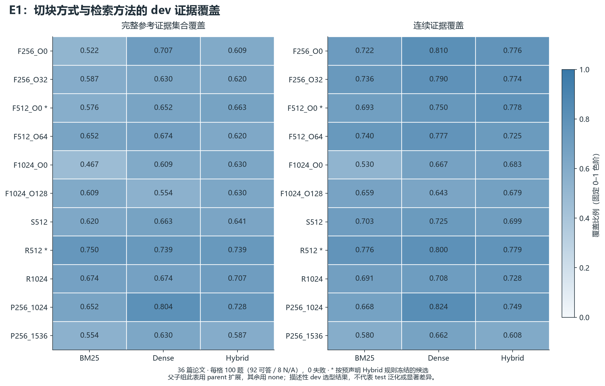

# 已完成的 dev 检索结果

预声明的 Hybrid 选择规则冻结了简单候选 **F512_O0** 和结构候选 **R512**，两者均采用邻块扩展。邻块扩展提高了完整参考证据集合覆盖，同时降低了连续证据覆盖；下面同时呈现两项指标。

这是 dev 选型报告。主矩阵 33 个条件，扩展诊断 8 个条件，共 4,100 条逐条件记录、0 失败；全部反复使用相同的 100 个问题、36 篇论文，不是 4,100 个独立问题。每条件 92 个可答题计入证据均值，8 个不可答题为 N/A。未纳入 test、全库未完成运行、R3 重排或生成模型结果。

## 检索方法与切块



所有 Dense/Hybrid 条件使用同一实际 Qwen3-Embedding-0.6B Q8_0 CPU 模型、相同 query 指令和目标 tokenizer，reference context 预算固定为 2048（包含标题与引用标签）。图中父子组先按 child 排序，再扩展 parent；其他组的主矩阵使用 none。

P256_1024 的 Dense 完整集合覆盖为 0.804348，高于其 Hybrid 的 0.728261。候选选择按实验前约定的 Hybrid 指标进行，因此保留 R512；没有事后改成选择最高的单个 Dense 单元。这里是描述性 dev 比较，未作显著性或 test 泛化结论。

## 邻块扩展的取舍


| 候选 | 完整集合覆盖 none → neighbor | 连续覆盖 none → neighbor |
|---|---:|---:|
| F512_O0 | 0.663043 → 0.684783（+2.17 pp） | 0.777828 → 0.707951（−6.99 pp） |
| R512 | 0.739130 → 0.750000（+1.09 pp） | 0.779438 → 0.755435（−2.40 pp） |

冻结规则先比较完整集合覆盖，再比较连续覆盖，容差 0.01 是工程选择容差，不是显著性阈值。这里完整集合覆盖增量略大于该容差，所以选择 neighbor；不能称为所有证据指标均有提升。

同题配对计数揭示了均值背后的替换：

| 候选 / 指标 | 改善题数 | 退步题数 | 不变题数 |
|---|---:|---:|---:|
| F512_O0 / 完整集合覆盖 | 16 | 14 | 62 |
| F512_O0 / 连续覆盖 | 16 | 19 | 57 |
| R512 / 完整集合覆盖 | 8 | 7 | 77 |
| R512 / 连续覆盖 | 8 | 8 | 76 |

每行分母均为92，可答题之外的8题仍是N/A。R512的完整覆盖不是只有一题变化，而是8题改善、7题退步，净增1题。该指标的单题均值步长是1/92≈0.01087，略大于预声明的0.01容差；因此一题净增就足以影响选型，这不能当作统计显著性证据。配对明细冻结于`analysis_complete_dev/EXPANSION_PAIRED_CHANGES.json`，无新增模型调用。

## 切块记录量


11 组共有 5,292 个 child 和 333 个 parent 记录。父块用于扩展映射，没有作为新增独立输入重复编码。这些数量只覆盖相同的 36 篇 dev 论文，不是正式 509 篇全库索引大小。构块耗时、正文 token 分布及原始参数保存在 SOURCE_SNAPSHOT.json，构块耗时不包含模型编码。

## 核验与复现

逐条原始记录和配置 hash、固定 dev ID 集合、16,412 个 context 原文片段全部核验。独立区间合并实现从 canonical 源坐标重算了 123 个汇总数字，并按 seed42 抽取 10 个数字单列如下。没有用汇总表反证汇总表，也没有将历史缺失的 backend token 用量补造出来。

| 运行 | 指标 | 独立求和 / 92 | 重算值 | 原始汇总 |
|---|---|---:|---:|---:|
| E1_P256_1536_bm25_parent | full_reference_coverage | 51.000000000 / 92 | 0.554347826 | 0.554347826 |
| E1_F1024_O128_dense_none | continuous_coverage | 59.117102389 / 92 | 0.642577200 | 0.642577200 |
| E1_F1024_O0_dense_none | full_reference_coverage | 56.000000000 / 92 | 0.608695652 | 0.608695652 |
| E1_R1024_dense_none | full_unit_recall | 65.100000000 / 92 | 0.707608696 | 0.707608696 |
| E1_F256_O32_hybrid_none | continuous_coverage | 71.164111013 / 92 | 0.773522946 | 0.773522946 |
| E1_F256_O32_dense_none | full_unit_recall | 64.208333333 / 92 | 0.697916667 | 0.697916667 |
| E1_F256_O32_bm25_none | full_unit_recall | 59.433333333 / 92 | 0.646014493 | 0.646014493 |
| E1_F1024_O128_hybrid_none | continuous_coverage | 62.496164979 / 92 | 0.679306141 | 0.679306141 |
| E1_F1024_O128_dense_none | full_unit_recall | 55.125000000 / 92 | 0.599184783 | 0.599184783 |
| E1_P256_1536_dense_parent | continuous_coverage | 60.933333333 / 92 | 0.662318841 | 0.662318841 |

原始、不可变分析快照：`D:/RAGScope_Runtime/runs/20261014_v2_retrieval/analysis_complete_dev/SOURCE_SNAPSHOT.json`。SHA-256：`eb7de862fe1603e18cbea2a26459560d3aed4e818d7aafa6a34180fe61633429`。逐图数据、PNG/SVG、图表设计、图像/数据清单均在本目录。图表不包含缓存命中查询与冷编码混合的延迟排名；真实在线端到端延迟由后续专门实验核验。

复现命令（保留原快照并验证其全部源 hash）：

```powershell
. ./scripts/runtime_env.ps1
& 'D:/RAGScope_Runtime/envs/reports/Scripts/python.exe' -u reports/v2/retrieval_interim/build_dev_figures.py --home D:/RAGScope_Runtime --campaign 20261014_v2
```
